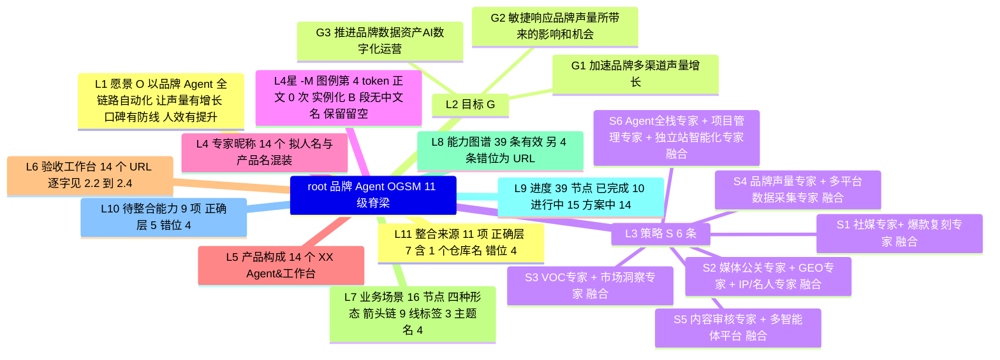
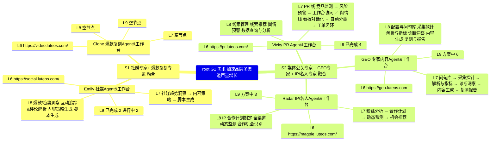
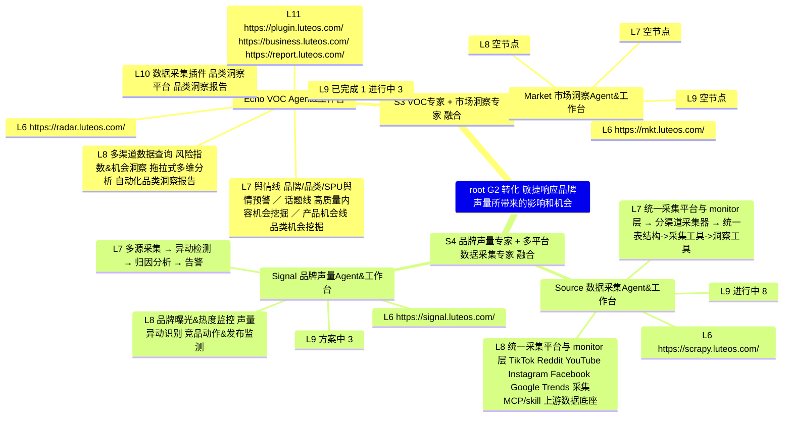
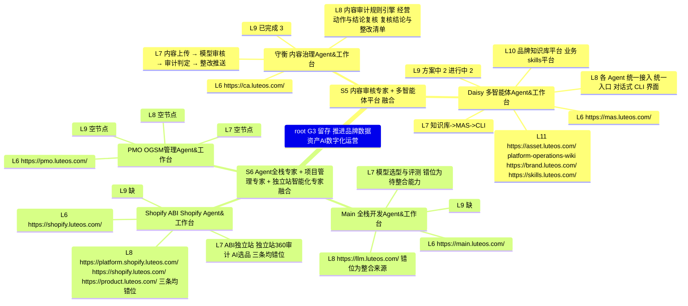

# 品牌 Agent OGSM 治理体系思维导图

原附件抬头 `# ABI-OGSM`（176 行）。O / G / S / 专家昵称 / 产品构成 / 网址全部逐字照抄；治理定义是接枝，不是改写。

## 0. 十秒版

**O 愿景**（原附件逐字）：

> 【O】以品牌 Agent 全链路自动化，让声量有增长、口碑有防线、人效有提升。

O v1（治理定义）：到 2027-12-31 结账；基线 = 2026-08-01 至 2026-10-31 十二周中位数，T0 锁定。R1 自然需求新客 CAC 较 2026 基线降 ≥15%（B2）；R2 MER 较基线升 ≥8%（B3）；R3 90 天同品类复购 ≥ B4 + 3pp 且 CAC payback 缩短 ≥15 天（D）；R4 单位 GMV 内容+运营人力成本 ≤ B6 × 0.80。四项一律取「净」：净声量 / 净新客 / 净增量 / 净人效。声量是乘数，不是结果。

| G | 一句话 | G-A | 结算主指标 |
|---|---|---|---|
| G1 需求 | 让人找到你并相信你 | Emily | 自然需求新客 CAC@2、品牌词搜索 |
| G2 转化 | 把注意力变成订单 | Paid Media | MER@1、首单贡献毛利 |
| G3 留存 | 让买过的人再买 | Retention | 复购 90@1、CAC payback@1 |
| 不占 G | Source 数据底座 · Daisy 事实底座 · 守衡 合规 gate · Echo 事实层 · PMO 治理机制 | — | 交付契约，不交付经营结果 |

**你坐哪**：先看 §5.1 的「段 A」列（执行问责），再看 §1.5 的「G-A」列（结果问责），最后看 §3 各产品的「对象级 A」（数据问责）。三张表不通用；一人可兼，但必须书面移交。

**今天只决定三件事**：① 三个 G-A 是否签移交条款（§6.4 T0）；② 14 条产线处置是否照 §1.6 执行；③ B-08 三键 30 天内是否落库——不落即按 §6.4 选择规则降级为最小改动。

**口径声明**：§6.1 的八条 blocker 已于 2026-11-01 晚修完，核验基准是第二轮复核版（源文档改于 19:12–19:14，复核稿 19:21）。最终状态是 8 条全修：BK-01—BK-08 均已闭合（BK-04/06/07 的残余由第三轮收敛：P0 尾句已改 9–17、版本串统一 `@3` 与 `{overlay_id}@`、G §6.3 标志 4 已同步新门槛、Gate 补 0 分母规则与 L3 模式分叉）。四个「审计建议值」里，P0 达 M2（BK-03）与授权七元组（BK-05）已落文；M2 门槛「≥20 次/周」（源文档仍写「≥N 次」）与 LTV 改 T+365（源文档仍在 180 天窗口内判定）未落文，引用时须同时给源文档现值。13 条 Major、7 条 Minor 未动。

**用词**：本图 owner = 唯一写入口负责方；A = RACI 问责位；steward = 过渡代持；其余不用。

**编号体系**（全文唯一口径）

| 前缀 | 含义 | 值域 | 备注 |
|---|---|---|---|
| L1–L11 | 骨架层级 | 11 | `L4*` 是图例 `-M` 的占位级 |
| S1–S6 | 原附件 6 条策略 | 6 | 只指骨架 L3 |
| CH1–CH11 | 治理段位（链路） | 11 | 源文档写作 S1–S11，与骨架 S1–S6 撞名，本图统一改 CH |
| M0–M4 | 能力成熟度 | 5 | 门槛 M0–M3，M4 只申报 |
| T1–T5 | 指标层级 | 5 | 源文档写作 L1–L5 层，与骨架 L1 撞名，本图统一改 T |
| C / A / X | Gate 触发点 | 4 / 5 / 5 | Claim / 授权 / 实验 |
| BP-xx | 交接断点 | 12 | 见 §5.2 |
| B-01–B-14 | 共享底座 | 14 | 见 §4 |
| BK-01–BK-08 | 审计 blocker | 8 | 见 §6.1；源审计写作 B-01..B-08，与底座撞名，改 BK |

---

## 1. 11 级脊梁总览（L1–L9 主线 + L10/L11 条件层）

### 1.1 骨架图（逐字）

```text
L1  愿景 / O      【O】以品牌 Agent 全链路自动化，让声量有增长、口碑有防线、人效有提升。
L2  目标 / G      【G1】 加速品牌多渠道声量增长
                  【G2】敏捷响应品牌声量所带来的影响和机会
                  【G3】 推进品牌数据资产AI数字化运营
L3  策略 / -S     6 条「XX专家 + XX专家 融合，为…提供…」
L4* -M            图例第 4 token；正文 0 次实例化；B 段无中文名 → 本图保留该级并留空，不删级、不补造
L4  专家昵称      Emily / Clone / Vicky / GEO / Radar / Echo / Market / Source / Signal / 守衡 / Daisy / Main / Shopify / PMO
L5  产品构成      14 个「XX Agent&工作台」
L6  验收工作台    14 个 URL
L7  业务场景      16 节点，四种形态混装：箭头流程链 9、线标签 3（全在 Echo）、主题名 4（Main 1 + Shopify 3）
L8  能力图谱      39 条有效能力条；另 4 条错位为 URL（Main 1 + Shopify 3）
L9  进度          已完成 10 / 进行中 15 / 方案中 14
L10 待整合能力    条件层，9 项：层级正确 5（Echo 3 + Daisy 2）、错位 4（Main 1 + Shopify 3）
L11 整合来源      条件层，11 项：正确层 7（6 个 URL + 1 个仓库名）、错位 4
```

图例原文分两段，共 15 个 token：A 段 `O / G / -S / -M`（`## / ### / - / 2空格-`），B 段 `愿景 / 目标 / 策略 / 专家昵称 / 产品构成 / 验收工作台 / 业务场景 / 能力图谱 / 进度 / 待整合能力 / 整合来源`。A 段与 B 段是同一套深度的两套命名：`愿景` = O、`目标` = G、`策略` = S；`-M` 在 B 段无对应项。本图 O 只叫 O 或愿景，G 才叫目标。

### 1.2 `-M` 的显式标注

`-M` 在图例里存在、在正文里 0 次实例化，B 段也没有给它中文名。附件里唯一具备「可判定状态」性质的内容是 L9 的「已完成 / 进行中 / 方案中」，它占据第 9 级「进度」，不是第 4 级 `-M`。本图保留 `L4*` 这一级并留空：不删级、不补造、不把三态上移冒充 M。把三态当成熟度，就是「用工程状态冒充业务状态」的起点（指标误用清单第 11 条）。

### 1.3 原附件每一级填了什么 vs 治理定义

| 级 | 原附件填了什么 | 治理定义给出什么 |
|---|---|---|
| L1 O | 三个「有」字句 | O v1 的 R1–R4；基线 B1–B6 与 D；四条反作弊：净声量 / 净新客 / 净增量 / 净人效 |
| L2 G | 3 个 G，按工具类型分组 | G1 需求 / G2 转化 / G3 留存；支撑层与准入 gate 不占 G |
| L3 S | 6 条产品组合叙事 | 14 条产线处置 + 4 条 P0；登记 18 项 |
| L4 专家昵称 | 14 个昵称，拟人名与产品名混装 | 统一实体语义 + 处置归属（合并 / 拆分 / 移出 / 观察 / 收窄） |
| L5 产品构成 | 14 个产品名 | 每个产品一句定位 + 不做什么 |
| L6 验收工作台 | 14 个 URL，没有验收含义 | URL 原样保留，另挂 CH 段 A / 主键 / Gate |
| L7 业务场景 | 功能流水线、「线」标签、主题名、待整合能力名；4 条层级错位 | 谁、什么触发、什么经营问题、业务动作链、交付物、验收、失败方式 |
| L8 能力图谱 | 能力条 + 4 条 URL；Source 末条是依赖声明 | 8 层能力原子（感知/理解/推理决策/生成/执行/评估/协同/记忆）+ 共享/专用 + 契约 ID |
| L9 进度 | 39 个状态节点：10 / 15 / 14 | 拆两栏；三态换算上限只到 M1 |
| L10 待整合能力 | 9 项，其中 4 项错位 | 14 项底座 B-01..B-14 挂载表（§4） |
| L11 整合来源 | 11 项，含仓库名 `platform-operations-wiki` | 各产品自建能力并入哪项底座 |

**O 的三处硬伤**：没有基线 / 目标值 / 时间窗；声量是中间变量，声量涨 30% 而品牌词搜索不动、新客 CAC 上升仍可宣布达成；声量可为负资产，不写「净」即可被刷量作弊。

**原 G 的三处结构性错误**：分组维度是工具类型不是业务结果（Echo 在 G2 做 VOC、Vicky 在 G1 做舆情可互换而无人被问责不同结果）；G3 用手段冒充目标（守衡是合规 gate、Daisy 是事实库、Main 是工程职能、PMO 是治理机制、Shopify 是渠道）；交易侧完全缺席（CH5 付费投放与 CH8 复购无产线）。

### 1.4 骨架统计

O / G / S = 1 / 3 / 6（S 实际 6 条，不是任务简报写的 5 条）；14 昵称对 14 产品；L8 / L9 各 39 项；空节点 3 个整段（Clone、Market、PMO）+ 2 个部分（Main、Shopify）。URL 出现 24 次、去重 23：L6 14 个；L11 正确层 6 个（另 1 项 `platform-operations-wiki` 是仓库名不是 URL）；L8 错位 4 个（去重 3，`https://shopify.luteos.com/` 与 L6 完全重复）。

**硬更正**：任务简报称「Source、Echo、Daisy 下面都有真正的两层」与原文不符。Source 的 8 条能力全部止于 L9，没有任何 L10/L11；真正带 L10/L11 的是 Echo（3 对）、Daisy（2 对 4 源），以及层级错位的 Main（1 对）、Shopify（3 对）。按「Source 有底座层」建模会漏掉 Main / Shopify 的错位形态。

### 1.5 新 G 结构：目标 / 主指标 / 窗口 / G-A

| G | 目标（首窗） | 经营主指标 | 时间窗 | G-A | 包含产线 | 不包含 |
|---|---|---|---|---|---|---|
| G1 需求 | 品牌自然需求新客 +15%；该来源 CAC ≤ B2×0.85；品牌词搜索 +20%；SOV +3pp | T1 `m-l1-cac@2`（按 acquisition_source 分层）；领先：品牌词搜索量、SOV | 2026-12-01 → 2027-03-01（13 周） | Emily | 内容产线（Emily+Clone）、Vicky-PR、GEO、Radar、Signal | 付费投放、站点与站内转化、Echo 事实层 |
| G2 转化 | MER +8%；首单贡献毛利 ≥ B3；独立站与 Amazon CVR 各 +10%；AOV ≥ 基线；CAC ≤ B2×1.10 | T1 `m-l1-mer@1` + `m-l1-cm@1`（首单分层）；领先：CVR、AOV、CAC | 2026-12-01 → 2027-03-01（13 周） | Paid Media | Paid Media、Shopify 三条、Amazon 站内 | 素材生产、售后与复购、履约与库存 |
| G3 留存 | 90 天同品类复购 +3pp；payback −15 天；退货率 ≤ B4；LTV +10% 仍随 T+180 判定（审计建议 T+365，未落文） | T1 `m-l1-rp90@1` + `m-l1-payback@1`；领先：首响中位、退货原因四层完成率、订阅留存 | 2026-12-01 → 2027-06-01（180 天，T+90 首读） | Retention | CS、Retention | 私域站点技术、客服话术合规裁决 |
| 不占 G | 数据底座 / 事实底座 / 合规 gate / VOC 事实层 / 治理机制 | 交付契约与覆盖率 | — | Source / Daisy / 守衡 / Echo / PMO | 全部业务线 | 不进 G、不进 M 的业务结果 |
| 准入 gate | S1 选品 + S2 合规：不放行则 G2 不开工 | 新品 90d 动销率、claim 可证率 | 随批次 | Market（steward）/ 守衡（内容侧） | — | 不作为第 4 个 G |

主指标 id 中的 `l1` 是源文档字面，指指标层，不是骨架 L1。三条准入规则：一个 G 必须有 ≥1 个外部结果、1 个 G-A、1 个 T1 主指标；底座、职能、平台不得占 G 位，共享能力必须服务 ≥3 条业务线；G 数上限 3，新增 G 必须替换现有 G，不设临时 G。

### 1.6 14 条产线处置与 4 条 P0

本节是今天唯一需要逐行过的表；其余章节都是它的证据，与本节冲突的以本节为准。

| 产线 | 处置 | 处置后归属 | 反证条件（出现即撤回） |
|---|---|---|---|
| Emily | 保留，与 Clone 合并为内容产线 | G1；策略域；G1-A + CH3-A | 合并后 8 周 L5-01 未降 ≥15%，或素材半衰期未升 ≥10% |
| Clone | 合并，砍掉投放场景 | G1；产能域；`variant_id` / `asset_id` 对象级 A | 1 个季度 variant 产出降 >20% 且归因结论数不增 |
| Vicky | 拆成 PR 与舆情 | PR → G1，CH4-A；舆情 → 支撑层事件服务，R | 同一事件仍出现两个 `event_id`，或 buyer guide 收录数降 >20% |
| GEO | 保留，砍内容生成，补 Amazon Rufus 与 TikTok Shop 站内 AI | G1；AI 可见度子域；零段 A | 砍内容生成后 AI 提及率／准确率无变化，或 2 个季度建不起 20 问/ASIN 复测 |
| Radar | 保留，收窄到 IP/名人 | G1；`creator_id` 对象级 A；达人供应链降为 R | 寄样回收率连续两季 <60%，或授权到期未回收 >5 |
| Echo | 保留，升为 VOC 主榜 owner | 支撑层事实层；段级 0 A | 2 个月内无稳定 taxonomy 只读接口，或抽检一致率 <85% |
| Market | 砍独立产线，90 天观察期 | CH1-A 由 PMO steward（T0 前必须指定到人；RACI §2 现仍写 Market A，M-02 未修） | 90 天内出现 ≥1 个下游书面承接且新品 90d 动销率 +5pp |
| Source | 保留，升为数据底座 | 支撑层；CH10-A；B-08 落库方 | 3 个月内归因覆盖率未升 ≥20pp，或断流 P95 未达 24h |
| Signal | 保留，拆出实验设计给 PMO | G1；CH9-A | 拆出后实验覆盖率未升，或「相关性结论进预算」次数 >0 |
| 守衡 | 保留，升为唯一合规裁决源 | 支撑层；CH2-A（内容侧） | 1 个季度 claim 返工工时未降 ≥30%，或误杀率 >15% |
| Daisy | 保留，移出业务 G | 支撑层；对象级 A；段级 0 A | 移出后 claim/evidence 冲突数上升，或下游出现第二事实源 |
| Main | 移出 OGSM，降为工程执行层 | CH10 的 R；不进 G、不进 M | 1 个季度工程交付延迟 >20%，或 B-12 抽检无法落地 |
| Shopify | 拆成三条并扩为 DTC 交易入口 | G2；DTC 转化、商品与定价、站点技术；CH6-DTC-A | 拆后 1 个季度 CVR 未升 ≥10%，或三线 `landing_ref` 一致率 <95% |
| PMO | 保留为治理机制，不当作产线 | 治理机制；CH11-A + 实验 gate + 指标字典 owner | 1 个季度承诺签署率 <90%，或 90 天裁决未砍掉任何策略 |

| P0 新增 | 段位 | 主指标 | A | 立项反证条件 |
|---|---|---|---|---|
| Paid Media | CH5 付费投放 | MER 与增量 ROAS | G2-A + CH5-A | 3 个月内预算变更单采纳率 <50% |
| CS & After-sales | CH7 履约售后 | 首响中位与退货原因四层完成率 | CH7-A | 6 个月内首响中位未达 8h，或退货原因四层完成率 <80% |
| Retention / Subscription | CH8 复购与 LTV | 90 天复购率与 CAC payback | G3-A + CH8-A | 2 个季度内 90 天复购率未升 ≥2pp |
| Amazon 站内 | CH6-AMZ | Amazon CVR 与 Buy Box 赢得率 | CH6-AMZ-A | 2 个月内建不起 Account Health 巡检与 Buy Box 快照 |

登记结果：18 项 = 12 条业务线 + 4 条支撑 + 1 条治理 + 1 条移出（Main）。三个数是嵌套关系：14 个产品（原附件）→ 登记 18 项 → 落 11 段（CH1–CH11），不是同一集合。

### 1.7 M 层：两栏、成熟度、指标五层与实验协议

`-M` 的标注见 §1.2。治理定义把 L9 拆成两栏：

| 栏 | 字段 | 关键规则 |
|---|---|---|
| 栏 A 能力图谱 | `capability_id`、层（感知/理解/推理决策/生成/执行/评估/协同/记忆）、原子名、owner、契约 ID、消费方、成熟度、最近验证 | owner 唯一，不写「多方共建」；消费方为空即 M1 |
| 栏 B 交付进度 | `work_item_id`、所属产线、交付物、状态、验收证据、blocker、依赖 | 状态语义保留，但不进 M 栏 |

桥接规则：一个 capability 对应多个 work_item，一个 work_item 也可交付多个 capability，用多对多映射，不做一对一。成熟度只能由消费方升级：至少 1 条非 owner 产线在生产环境调用并通过契约测试，才允许 M1 → M2。

三态换算只到 M1：已完成（单产线内）= M1 上限；进行中 = M0–M1；方案中 = M0；跨线无对应行的记 M0 并显式登记为空洞。三态一律不进 M 栏。

**M 阶梯**：M0 未建/空洞 → M1 功能可用（标准输入得符合 schema 的输出，失败有错误码）→ M2 流程跑通（连续 4 周真实调用 ≥20 次/周、交接字段 100% 回填、无人工兜底；20 为审计建议值，源文档仍写 ≥N）→ M3 质量达标（人工 golden set + 抽检一致率）→ M4 结果改善（T1 财务口径认可）。

**阶梯口径冲突（待裁定）**：补全稿是 L0–L5 六级（含 L4 过程改善、L5 结果改善）；指标字典 §14.4 是 M0–M4 且明写「M3 质量达标以上才允许申报 T1 结果」。本图把「过程改善」并入 M4，与 §14.4 冲突，须先裁定再写门槛。本图门槛按 M0–M3，M4 只申报。

**指标五层（T1–T5，共 38 项）**

| 层 | 项数 | 决策用途 | 内容 |
|---|---|---|---|
| T1 财务口径 | 9 | `budget` | GMV、贡献毛利、退货率、CAC、MER、LTV、payback、90 天复购、180 天复购；定义权在财务，PMO 只有登记权 |
| T2 声量与中间指标 | 9 | `explain_only` | SOV、品牌词搜索量、品牌词 CVR、自然搜索占比、非品牌/品牌流量比、review velocity、星级、NTB 占比、内容复用率 |
| T3 投放与素材 | 8 | `explain_only` | ROAS、CPM、CTR、CVR、频次、素材半衰期、2s/6s 播放率、素材单条成本；前五项禁止进 M 栏 |
| T4 质量与过程 | 6 | `gate_only` | claim 预检通过率、授权覆盖率、一次通过率、gate 判定时长、漏检率、误杀率；不得设「越高越好」 |
| T5 人效 | 6 | `settlement` | 素材上线中位工时、单位 GMV 人力成本、人均管理对象数、一次通过率复用、等待时间占比、全局账 L5-06 |

12 条指标误用：M01 平台 ROAS 当经营结论；M02 营收口径算 LTV；M03 全店复购掩盖品类；M04 mention 次数当 SOV；M05 AVE 当 PR 价值；M06 讲师宣称当投放基准；M07 全店 CVR 归因单条素材；M08 含运含税 GMV 与净 GMV 混算；M09 30 天与 90 天退货率混比；M10 样本不足的 A/B「提升 10」进预算；M11 交付进度当经营结果；M12 平台归因窗口 GMV 算 CAC payback。每条配一条可判定检测规则，复核对象是材料不是人。

**实验协议四条件**：① `hypothesis_id`（`hyp-{yyMMdd}-{seq3}`，PMO 发号，无编号不进测试）；② `metric_dict@{version}` + baseline + 窗口 + MDE（口径版本缺失不得开测）；③ `sample_size`（按比例 z 公式，分臂列出）；④ `correction_method`（15 条以上同批必填，Holm-Bonferroni 控 FWER）。三条硬规则：预注册 14 字段 + 阈值哈希，开测后改阈值即批次作废；结果只分 scale / kill / inconclusive，inconclusive 不得进任何决策；「必须对照」的决策没有对照就不做决策，时间不够的解法是缩小实验范围，不是降级证据等级。

**校正后样本量（BK-08 已落文：指标 §10.2、Gate §4.4）**（k=5，单臂 α=0.01，系数 11.68，约为 α=0.05 表值的 1.49 倍）：素材 CTR ≈34,600 曝光/臂；站点 CVR +10% ≈120,200 会话/臂；90 天复购 +3pp ≈4,070 人/臂。体量不足只允许三条降级路径（指标 §10.2 另给月销 30 万美金的逐条演算）：降臂数到 2、放大 MDE（月会话 3 万时 CVR 相对 MDE 不低于 17%）、改判观察（结论标「不可进预算」）。禁止改 α、改 power、事后加臂、把 inconclusive 写成 hold。

---

## 2. 图形版 Mermaid

四张图，单张 ≤30 节点。取舍：产品字段级子树与 §3 的逐级对照表 100% 同源，图里只保留「产品 → 原 L6 / L7 / L8 / L9」四行原文，治理定义走 §3。mindmap 是树，六处循环依赖画不出来，见 §5.5；主键链是链不是树，见 §5.3。

### 2.1 骨架总览（22 节点）



### 2.2 G1 需求（28 节点）



### 2.3 G2 转化（原：敏捷响应）（25 节点）



### 2.4 G3 留存（原：数据资产）（30 节点）



---

## 3. 分层文字树与产品节点

### 3.0 每条产线先答「不解决会怎样」

14 条线共 74 条核心问题，每条含「谁被折磨 / 触发时点 / 不用的现状 / 不解决的代价」，另有 68 个场景、202 行能力、31 条边界。不回答这个问题的产线不该进 OGSM。每线只留 1 条最贵的示例：Emily 的趋势窗 2–4 周而选题到开拍 3 周，被迫买流量使 CAC 上浮 20–30%。

### 3.1 11 级分层文字树

```text
L1 O ─ L2 G ─ L3 S ─ L4* -M（空）─ L4 专家昵称 ─ L5 产品构成 ─ L6 验收工作台
                                              └ L7 业务场景 ─ L8 能力图谱 ─ L9 进度
                                                              └ L10 待整合能力 ─ L11 整合来源

G1 需求
├─ Emily  → L4 Emily｜L5 社媒Agent&工作台｜L6 https://social.luteos.com/｜L7 1 条｜L8 4 项｜L9 2+2｜L10 无｜L11 无
├─ Clone  → L4 Clone｜L5 爆款复刻Agent&工作台｜L6 https://video.luteos.com/｜L7 空｜L8 空｜L9 空｜L10 无｜L11 无
├─ Vicky  → L4 Vicky｜L5 PR Agent&工作台｜L6 https://pr.luteos.com/｜L7 2 条｜L8 4 项｜L9 4｜L10 无｜L11 无
├─ GEO    → L4 GEO｜L5 专家内容Agent&工作台｜L6 https://geo.luteos.com｜L7 6 步｜L8 6 项｜L9 6｜L10 无｜L11 无
└─ Radar  → L4 Radar｜L5 IP/名人Agent&工作台｜L6 https://magpie.luteos.com/｜L7 4 步｜L8 3 项｜L9 3｜L10 无｜L11 无

G2 转化（原：敏捷响应）
├─ Echo   → L4 Echo｜L5 VOC Agent&工作台｜L6 https://radar.luteos.com/｜L7 3 线｜L8 4 项｜L9 1+3｜L10 3｜L11 3
├─ Market → L4 Market｜L5 市场洞察Agent&工作台｜L6 https://mkt.luteos.com/｜L7 空｜L8 空｜L9 空｜L10 无｜L11 无
├─ Source → L4 Source｜L5 数据采集Agent&工作台｜L6 https://scrapy.luteos.com/｜L7 5 段｜L8 8 项｜L9 8｜L10 无｜L11 无
└─ Signal → L4 Signal｜L5 品牌声量Agent&工作台｜L6 https://signal.luteos.com/｜L7 4 步｜L8 3 项｜L9 3｜L10 无｜L11 无

G3 留存（原：数据资产）
├─ 守衡   → L4 守衡｜L5 内容治理Agent&工作台｜L6 https://ca.luteos.com/｜L7 4 步｜L8 3 项｜L9 3｜L10 无｜L11 无
├─ Daisy  → L4 Daisy｜L5 多智能体Agent&工作台｜L6 https://mas.luteos.com/｜L7 1 段｜L8 4 项｜L9 2+2｜L10 2｜L11 4
├─ Main   → L4 Main｜L5 全栈开发Agent&工作台｜L6 https://main.luteos.com/｜L7 错位 1｜L8 错位 1｜L9 缺｜L10 无｜L11 无
├─ Shopify→ L4 Shopify｜L5 ABI Shopify Agent&工作台｜L6 https://shopify.luteos.com/｜L7 错位 3｜L8 错位 3｜L9 缺｜L10 无｜L11 无
└─ PMO    → L4 PMO｜L5 OGSM管理Agent&工作台｜L6 https://pmo.luteos.com/｜L7 空｜L8 空｜L9 空｜L10 无｜L11 无
```

L1 / L2 是全局值，见 §0 与本节 G 标题，不在 14 个产品下重复。L10 / L11 原文为空时标「无」，并区分「结构上不需要」与「应填未填」。

### 3.2 G1 需求｜【G1】 加速品牌多渠道声量增长

**S1 社媒专家+ 爆款复刻专家 融合，为社媒趋势把控、爆款选题、拍摄脚本、AI素材生成提供辅助决策类和生产力工具**

**S2 媒体公关专家 + GEO专家 + IP/名人专家 融合，为品牌公共关系从核心媒体编辑跟踪、声量洞察、专家挖掘助力**

#### 3.2.1 Emily｜社媒Agent&工作台

| 字段 | 值 |
|---|---|
| 现状 | M1 上限（原附件：已完成 2 / 进行中 2，2026-11-01 快照） |
| 治理后归属 | G1 需求；G1-A + CH3-A；对象级 A = `script_id` |
| 处置与反证 | 保留，与 Clone 合并为内容产线；合并后 8 周 L5-01 未降 ≥15% 即撤回 |
| 上游依赖 | Source B-01 趋势 · 守衡 B-06 claim 规则 · Daisy B-09 事实库 · Signal B-03 声量口径 |
| 下游消费 `[推断]` | Clone（读 `script_id@version`）· 守衡 C1 审批 · G1 主指标（品牌词搜索、内容复用率） |
| 唯一写入口 | `script_id`；Gate C1 + X1；断点 BP-02 / BP-03 / BP-26 / BP-27 |

| 级 | 原附件（逐字） | 治理定义接枝 |
|---|---|---|
| L3 S | S1（逐字见本节组标题） | 与 Clone 合并为内容产线，内部保留策略域与产能域两套验收；策略侧对产能排期有否决权 |
| L4 专家昵称 | Emily | 保留；G1-A + CH3-A 兼任；对象级 A = `script_id` |
| L5 产品构成 | 社媒Agent&工作台 | 内容链路上游决策位：说什么、对谁讲、凭什么算有效；不做成片、不做投放出价 |
| L6 验收工作台 | https://social.luteos.com/ | 工作台保留；CH 段 A = CH3；Gate C1 + X1；写 `script_id`，读 `claim_id@version` 与 `variant_id` |
| L7 业务场景 | 社媒趋势洞察 → 内容策略 → 脚本生成 | 场景 1「抢趋势窗口」（周）：拉近 30 天 Top100 与上升音源 → 剔除儿童出镜、他牌 logo、平台禁用 claim → 按钩子 × 痛点 × offer 聚类并标出增速转负的尸体趋势。验收：7 天 ≥5 条脚本，≥3 条过 claim 预检，≥1 条 14 天内 CTR 达品类基线 1.5–2%。场景 2「objection 回流」（双周）：拉评论与 DM → 归 objection 类型 → 筛 3 个高频未覆盖项。验收：每轮 ≥3 个 objection 有脚本覆盖，同类占比下一轮降 ≥20% |
| L8 能力图谱 | 爆款/趋势洞察：发现社媒爆款与趋势，输出可复刻的内容结构（已完成）；互动追踪&评论解析：追踪社媒互动并解析粉丝真实反馈（已完成）；内容策略生成：按趋势与品牌定位生成社媒内容策略（进行中）；脚本生成：按爆款结构批量生成品牌投放脚本（进行中） | 关键原子 ≤6：归一化多平台趋势信号（B-01/B-03）、归类钩子与卖点叙事结构（专用）、匹配 claim 约束（B-06）、判断趋势可跟性（专用）、生成脚本与分镜（专用）、沉淀钩子库与 claim 证据库（B-09）。断点：BP-02、BP-03、BP-26/27 |
| L9 进度 | 已完成 2、进行中 2 | 换算上限 M1；M2 要求连续 4 周真实调用 ≥20 次/周、交接字段 100% 回填、无人工兜底；M2 只能由非 owner 消费方升级 |
| L10 / L11 | 无 | 应消费 B-01 采集、B-03 声量归一、B-06 claim 校验、B-09 品牌事实库，不重复建设；自建的内容互动监听、趋势归一、objection 归类并入 B-01/B-03/B-05，claim 库降为只读缓存 |

#### 3.2.2 Clone｜爆款复刻Agent&工作台

| 字段 | 值 |
|---|---|
| 现状 | 空节点（L7–L11 全无）；不得用「网址已上线」冒充任何成熟度，记 M0 空洞 |
| 治理后归属 | G1 内容产线产能域；不持段 A；对象级 A = `variant_id` + `asset_id(content_*)` |
| 处置与反证 | 合并进内容产线，砍掉投放场景（移交 Paid Media）；1 个季度 variant 产出降 >20% 且归因结论数不增即撤回 |
| 上游依赖 | Emily `script_id@version` · Radar B-14 授权状态 · Source B-01 素材解析 |
| 下游消费 `[推断]` | Paid Media（读 `variant_id` 与授权状态）· 守衡 C2 入库校验 · G1 主指标（内容复用率） |
| 唯一写入口 | `variant_id` / `asset_id`；Gate A2 + C2；断点 BP-03 / BP-11 / BP-16 / BP-27 |

| 级 | 原附件（逐字） | 治理定义接枝 |
|---|---|---|
| L3 S | S1（逐字见 3.2 组标题） | 与 Emily 合并；保留产能、谱系、授权、疲劳四项 |
| L4 专家昵称 | Clone | 保留在合并后的内容产线；产能域负责人独立于 G1-A，不得兼任 |
| L5 产品构成 | 爆款复刻Agent&工作台 | 内容链路下游产能位：把已验证结构做成能过审、能跑量、可归因的素材；不做投放出价与预算 |
| L6 验收工作台 | https://video.luteos.com/ | 工作台保留；RACI 无段 A；Gate A2 + C2；写 `variant_id` / `asset_id`，读 `script_id@version` |
| L7 业务场景 | 无（空节点） | 场景「结构复刻」（事件驱动）：拉原片逐帧拆解 → 标可迁移机制与不可迁移皮 → 对照可用资产清单 → 设计单变量变体矩阵 15 条。验收：5 个工作日 ≥15 条变体，100% 有谱系标签，单变量比例 ≥80%，≥1 条 CTR 达被复刻原片基线的 80%。场景 2「疲劳预警」：按素材维度监控 CTR/CPM/频次/加购 → 三分正常/衰减/已死 → 提前 3 天进替换队列。验收：衰减后 48 小时内完成替换决策，浪费 ≤5% |
| L8 能力图谱 | 无（空节点） | 关键原子 ≤6：拆解视频结构与可迁移机制（专用）、判定素材来源与授权边界（B-14）、设计单变量变体矩阵（专用）、批量生产素材变体（专用）、平台规格化与标注（专用）、素材谱系登记（专用）。断点：BP-03、BP-11、BP-16、BP-27 |
| L9 进度 | 无（空节点） | 换算 M0，且必须显式登记为空洞 |
| L10 / L11 | 无 | 应挂 B-14 达人与授权档案；视频解析/ASR 并入 B-01；素材授权台账并入 Radar 的 `asset_rights`；平台规格清单并入 B-13 |

#### 3.2.3 Vicky｜PR Agent&工作台

| 字段 | 值 |
|---|---|
| 现状 | M1 上限（原附件：已完成 4） |
| 治理后归属 | PR 进 G1 持 CH4-A；舆情线进支撑层事件服务，只做 R；对象级 A = `asset_id(earned_coverage)` |
| 处置与反证 | 拆成 PR 与舆情；同一事件仍出现两个 `event_id`，或 buyer guide 收录数降 >20% 即撤回 |
| 上游依赖 | Source B-01 监听 · Signal B-07 事件主单 · Daisy B-09 事实库 · Radar B-04 达人实体 |
| 下游消费 `[推断]` | G1 主指标（品牌词搜索、SOV）· Echo / CS / Paid Media 消费事件单 · GEO 引用源 |
| 唯一写入口 | `asset_id(earned_coverage)`，追加 `event_observation`；Gate C3 + A1；断点 BP-04 / BP-06 / BP-11 |

| 级 | 原附件（逐字） | 治理定义接枝 |
|---|---|---|
| L3 S | S2（逐字见 3.2 组标题） | 拆成 PR 与舆情；PR 的外部对象是媒体编辑，舆情的外部对象是事件；共线会导致 coverage 与 severity 两套口径 |
| L4 专家昵称 | Vicky | 保留；CH4-A；舆情线只做 R，`event_id` 写入口归 Signal |
| L5 产品构成 | PR Agent&工作台 | earned media 关系与声誉防守段：把媒体/编辑关系变成可复用、可验证、可归因的第三方信任资产；不做内容生产、不做声量数量 |
| L6 验收工作台 | https://pr.luteos.com/ | 保留；Gate C3（分发目标含 pr）+ A1（若进 paid）；写 `asset_id(earned_coverage)`，追加 `event_observation` |
| L7 业务场景 | PR 线：竞品监测 → 风险预警 → 工作台协同；舆情线：看板对话化 → 自动分类 → 工单闭环 | 场景 1「季度 editorial 攻占」：定 3 个议题 → 反查 90 天写过该议题的媒体与作者拉 60 位 → 按 media fit / beat / 可达性 / 互动分 A/B/C 砍到 40 位。验收：90 天 40 位 fit≥B 全部触达，回复率 ≥8%，≥5 篇 organic，其中 ≥2 篇 buyer guide，0 起 route 误判。场景 2「舆情分级到回扫」：多源去重 → 分类 → 按媒体级别 × 传播速度 × 事实严重性定 P0–P3 → 30 分钟派单 → 处置 → 48 小时回扫。验收：P0 30 分钟触达，48 小时回扫 100%，同类事件季度重复 ≤1 |
| L8 能力图谱 | 线索管理： PR 媒体&编辑线索管理（已完成）；线索推荐：行业话题推荐、编辑匹配（已完成）；舆情预警：品牌舆情监控与预警分发（已完成）；数据查询与分析：舆情、核心媒体&编辑查询与分析（已完成） | 关键原子 ≤6：媒体与编辑源监测（B-01/B-03）、判定媒体 fit 与 beat（专用）、判定合作 route（专用）、事件分类与影响面分级（B-07）、coverage 质量与授权矩阵（专用）、编辑关系记忆（专用）。断点：BP-04、BP-06、BP-11 |
| L9 进度 | 已完成 4 | 换算上限 M1；舆情线并入事件服务后，M2 由 Echo / CS / Paid Media 三个消费方升级 |
| L10 / L11 | 无 | 应消费 B-07 事件去重与主单；舆情分级并入 Signal 的 `event_type` / `severity`；自建舆情采集与分级下线并入 B-01 + B-07；coverage 资产卡并入 `asset_id(earned_coverage)` |

#### 3.2.4 GEO｜专家内容Agent&工作台

| 字段 | 值 |
|---|---|
| 现状 | M0（原附件：方案中 6） |
| 治理后归属 | G1 AI 可见度子域；零段 A、零对象级 A（全表唯一） |
| 处置与反证 | 保留，砍内容生成，补 Amazon Rufus 与 TikTok Shop 站内 AI；砍后 AI 提及率／准确率无变化，或 2 个季度建不起 20 问/ASIN 复测即撤回 |
| 上游依赖 | Daisy B-09 事实库 · 守衡 B-06 claim 校验 · Source B-04 实体消歧 · PMO B-11 口径 |
| 下游消费 `[推断]` | G1 领先指标（AI 提及率，当前无主键宿主）· 守衡 C2/C3 分发 |
| 唯一写入口 | 读 `claim_id`、`evidence_id`；缺 `ai_answer_snapshot_id`；Gate C2 / C3；断点 BP-02 |

| 级 | 原附件（逐字） | 治理定义接枝 |
|---|---|---|
| L3 S | S2（逐字见 3.2 组标题） | 保留测量闭环，砍内容生成（T+2 关闭）；补 Amazon Rufus 与 TikTok Shop 站内 AI |
| L4 专家昵称 | GEO | 保留；两类 A 都没有；90 天裁决会被判为可并入 |
| L5 产品构成 | 专家内容Agent&工作台 | AI 搜索可见度的测量与攻占：护城河是问句库 → 采集探针 → 指标 → 诊断 → 内容 → 复测的闭环，不是内容生成本身 |
| L6 验收工作台 | https://geo.luteos.com | 保留原样，无尾斜杠；Gate C2/C3；读 `claim_id@version`、`evidence_id`，缺 `ai_answer_snapshot_id` |
| L7 业务场景 | 问句库 → 采集探针 → 解析与指标 → 诊断洞察 → 内容生成 → 复测报告 | 场景 1「建立品牌问句库与多引擎基线」：按品类决策、场景、对比、品牌、疑虑 5 类生成 300–500 条 → 每条标市场/类目/购买阶段/意图价值/产品线 → 5 个引擎与地区跑基线，记录提及/排位/引用源/准确性。验收：≥300 条带版本，5 引擎 × 目标地区，四项记录齐全。场景 2「缺口诊断」：解析五项指标 → 按意图价值 × 缺口 × 可攻占性排 Top10 → 每个缺口归因到内容不存在/不被引用/事实冲突/引用源被占。验收：每月 Top10 带归因、owner、动作、复测判据 |
| L8 能力图谱 | 配置与问句库：建立品牌问句库并版本化管理（方案中）；采集探针：真实采集 AI 引擎回答并留存快照（方案中）；解析与指标：解析品牌提及与排位，算出五项可见度指标（方案中）；诊断洞察：定位可见度缺口并排出优先攻占主题（方案中）；内容生成：基于事实库生成可被 AI 引用的权威内容（方案中）；复测与报告：复测效果并产出可交付月报（方案中） | 关键原子 ≤6：AI 引擎回答采集与快照（专用，Source 覆盖不到的唯一例外）、引用源与占位归因（专用）、实体消歧（B-04）、claim 与事实校验（B-06）、缺口诊断与优先级（专用）、结构化内容生成（T+2 关闭）。断点：BP-02；无主键宿主 |
| L9 进度 | 方案中 6 | 换算 M0；`m-x-ai-mention` 与 `m-x-ai-accuracy` 无公式、无主键宿主，不得进 M 栏 |
| L10 / L11 | 无 | 应消费 B-06 claim 与事实校验、B-09 品牌事实库；不自建采集器，只采 AI 引擎回答；事实源并入 Daisy，引用源数据并入 B-01，内容生成能力并入 Emily 的权威内容生产规格 |

#### 3.2.5 Radar｜IP/名人Agent&工作台

| 字段 | 值 |
|---|---|
| 现状 | M0（原附件：方案中 3） |
| 治理后归属 | G1；IP/名人线；对象级 A = `creator_id` + `asset_rights` 唯一写入口（七元组已落文：字典 §0.8、Gate §3、P0 §5、RACI §1.2）；不持段 A |
| 处置与反证 | 保留并收窄到 IP/名人；寄样回收率连续两季 <60%，或授权到期未回收 >5 即撤回 |
| 上游依赖 | Source B-01 达人内容监测 · Daisy B-04 实体消歧 · 自有 B-14 档案 |
| 下游消费 `[推断]` | Clone（授权判定）· Paid Media（放大授权）· Emily（达人 brief） |
| 唯一写入口 | `creator_id` 与 `asset_rights`；Gate A1 / A2 / A5；断点 BP-10 / BP-11 |

| 级 | 原附件（逐字） | 治理定义接枝 |
|---|---|---|
| L3 S | S2（逐字见 3.2 组标题） | 保留并收窄到 IP/名人；达人供应链（寄样/回收/结算/授权回收）降为支撑层 creator 域 R；affiliate 90 天临时归 Radar |
| L4 专家昵称 | Radar | 保留；对象级 A 见节点头 |
| L5 产品构成 | IP/名人Agent&工作台 | 达人/IP 合作的权属与商业路线 owner：定找谁、给什么约束、素材能用到哪、这次合作值多少 |
| L6 验收工作台 | https://magpie.luteos.com/ | 保留；Gate A1 / A2 / A5（台账写域）；写 `creator_id` 与 `asset_rights` |
| L7 业务场景 | 粉丝分析 → 合作计划 → 动态监测 → 机会推荐 | 场景 1「新品首发达人金字塔」：5 个工作日 ≥40 个候选、覆盖 4 层级，wave-1 ≥12 人，每个候选有公开合作入口与 route 判定。验收：审定通过率 ≥60%，editorial-only 与 no-sponsorship 对象为 0。场景 2「爆量 48 小时授权放大」：识别首条付费素材 → 核授权四类覆盖 → 首批测试预算 ≤$1000。验收：48 小时内上线，每条放大素材 100% 有书面凭证与到期日 |
| L8 能力图谱 | IP 合作计划制定：分析 IP 粉丝结构与声量，输出合作计划（方案中）；全渠道动态监测：跨平台追踪 IP 动态并聚类关键事件（方案中）；合作机会识别：识别合作机会信号并给出推荐理由（方案中） | 关键原子 ≤6：监测达人内容与互动异动（B-01）、判定商业路线与门禁（专用）、识别素材可放大性与授权状态（B-14）、配置分层与预算配比（专用）、生成约束型 brief（专用）、维护合作资产档案（B-14）。断点：BP-10、BP-11 |
| L9 进度 | 方案中 3 | 换算 M0；M2 需 Paid Media 与 Clone 两个消费方实际调用授权接口 |
| L10 / L11 | 无 | 应挂 B-14 达人与授权档案，作为唯一「待整合能力」宿主；不再新建第 15 个工作台；Clone 授权台账、Emily 达人 brief、affiliate 名单并入 `creator_id` 与 `asset_rights` |

### 3.3 G2 转化（原：敏捷响应）｜【G2】敏捷响应品牌声量所带来的影响和机会

> 原 G2 四条产线治理后没有一条留在 G2：Echo 下沉事实层、Market 观察期、Source 下沉数据底座、Signal 上移 G1。新 G2 是三条新增产线（Paid Media / Shopify / Amazon 站内），全部从零立项、M0。**所以 G2 在本季度没有任何存量可结算。** 原 G2 四条仍按原文结构列出，保证骨架不丢。

**S3 VOC专家 + 市场洞察专家 融合，为品牌消费者舆情监控、品牌声量机会识别、竞品洞察提供辅助决策**

**S4 品牌声量专家 + 多平台数据采集专家 融合，为品牌知识库构建、声量建模、声量分析提供辅助决策**

#### 3.3.1 Echo｜VOC Agent&工作台

| 字段 | 值 |
|---|---|
| 现状 | M1 上限（原附件：已完成 1 / 进行中 3） |
| 治理后归属 | 支撑层事实层；段级 0 A；不持经营结果；taxonomy 版本化为问责依据 |
| 处置与反证 | 保留并升为 VOC 主榜 owner；2 个月内无稳定 taxonomy 只读接口，或抽检一致率 <85% 即判可并入 |
| 上游依赖 | Source B-01 多源接入 · Source B-04 实体消歧 · 守衡 B-06 claim 规则 |
| 下游消费 `[推断]` | Emily（objection 榜）· 守衡（卖点比对）· CS（差评根因）· Market（机会卡） |
| 唯一写入口 | 追加 `event_observation`，读 `claim_id` / `asset_id`；不持 Gate，为 C1 供证据；断点 BP-04 / BP-02 |

| 级 | 原附件（逐字） | 治理定义接枝 |
|---|---|---|
| L3 S | S3（逐字见 3.3 组标题） | 保留并升为 VOC 主榜 owner；Market 砍独立产线后机会卡并入 Echo 输入 |
| L4 专家昵称 | Echo | 保留；段级 0 A；taxonomy 未进 8 主键，问责靠 taxonomy 版本与抽检一致率 |
| L5 产品构成 | VOC Agent&工作台 | 回答说了什么、指向哪个 SKU 与哪句卖点、该怎么改；服务产品与运营 |
| L6 验收工作台 | https://radar.luteos.com/ | 保留；不持 Gate；主键只追加 `event_observation`，读 `claim_id` |
| L7 业务场景 | 舆情线：品牌/品类/SPU舆情预警；话题线：高质量内容机会挖掘；产品机会线：品类机会挖掘 | 场景 1「新品差评根因」：T+3 定位变体与 listing 承诺失准 → 派整改项 → T+14 复核。验收：尺码/适配类一星二星占比降 ≥30%，每条整改项有 owner、deadline、回填证据，挂空率 0，未达阈值必须写未解决原因。场景 2「objection 变 PDP 承接」：前 10 条 objection 中 ≥8 条能指认到 PDP 具体位置，100% 过守衡预检；上线 14 天提及率降 ≥30% 或该页 CVR 升 ≥10%，至少达成一项并附样本量 |
| L8 能力图谱 | 舆情线：多渠道数据查询：售前、售后、独立站、Reddit 等用户反馈（已完成）；风险指数&机会洞察：量化用户风险指数并挖掘产品机会（进行中）｜话题线：拖拉式多维分析：拖拽式多维分析用户声音（进行中）｜产品机会线：自动化品类洞察报告（进行中） | 关键原子 ≤6：多源声音接入（B-01）、评论树与说话人还原（专用）、评论到 SPU/变体绑定消歧（B-04）、卖点承诺比对（B-06）、VOC 四字段打标（B-05）、风险指数与平台门槛对齐（专用）。断点：BP-04、BP-02 |
| L9 进度 | 已完成 1、进行中 3 | 换算上限 M1；taxonomy 只读接口与抽检一致率 ≥85% 是保留条件 |
| L10 待整合能力 | 数据采集插件；品类洞察平台；品类洞察报告 | 三者在治理定义下都不是「待整合能力」，而是应被 B-01 采集与 B-05 taxonomy 吸收的下游；Echo 只保留「未满足需求主题 + 原话证据」 |
| L11 整合来源 | https://plugin.luteos.com/；https://business.luteos.com/；https://report.luteos.com/ | 采集插件并入 Source；品类洞察平台与报告移交 Market 或降为 Echo 报告模板，不再单独建平台 |

#### 3.3.2 Market｜市场洞察Agent&工作台

| 字段 | 值 |
|---|---|
| 现状 | 空节点（L7–L11 全无），记 M0 |
| 治理后归属 | 准入 gate CH1；90 天观察期；CH1-A 由 PMO steward 代持，T0 前必须指定到人 |
| 处置与反证 | 砍独立产线；90 天内出现 ≥1 个下游书面承接且新品 90d 动销率 +5pp 才保留，否则关闭 |
| 上游依赖 | Source B-02 经营数据接入（当前缺 Amazon BSR/价格/上新）· B-13 类目合规 |
| 下游消费 `[推断]` | 守衡 CH2 合规准入 · Paid Media 与 Shopify 的新品输入包 · Echo 机会卡 |
| 唯一写入口 | `opportunity_id`（B-08 第 14 候选键）、`category_id`（第 15 候选键）；Gate CH1→CH2 准入；S1→S2 属 6 条域外键交接之一（BK-04 已修：9 键按第 9–17 登记）：键登记前只记记录项，S2 可开工 |

| 级 | 原附件（逐字） | 治理定义接枝 |
|---|---|---|
| L3 S | S3（逐字见 3.3 组标题） | 与 Echo 融合；若保留独立，必须同时满足三条：品类洞察报告整体迁出、独立事实库与 Source 补齐 Amazon BSR/价格、产出被至少一个决策消费 |
| L4 专家昵称 | Market | 观察期；RACI 现状 S1 行 A = Market，审计 M-02 判为冲突，应改 `C`、PMO 列改 `A` |
| L5 产品构成 | 市场洞察Agent&工作台 | 品类机会、价格带、竞品动作与市场进入判断；回答这个类目值不值得进 |
| L6 验收工作台 | https://mkt.luteos.com/ | 保留；无 Gate |
| L7 业务场景 | 无（空节点） | 场景 1「细分品类是否值得进入」：机会卡必须带数据来源、样本量、时间窗与「不进入的代价」。验收：季度 ≥1 个明确结论（进入/不进入/换切角）在 2 周内进入立项或否决记录；只写「建议继续观察」视为未交付。场景 2「竞品动作响应」：每周竞品集合覆盖率 100%，每个高影响动作 48 小时内给出跟/不跟/差异化与代价测算 |
| L8 能力图谱 | 无（空节点） | 关键原子 ≤6：品类与竞品事实接入（B-02，当前缺 Amazon BSR/价格/上新）、品类边界与竞品集合（专用）、价格带与价格-销量建模（专用）、竞品动作性质判定（专用）、类目合规门槛核对（B-13）、机会卡与新品输入包（专用）。断点：CH1→CH2 属 6 条域外键交接之一（BK-04 已修，登记前只记记录项） |
| L9 进度 | 无（空节点） | 换算 M0，登记为空洞；观察期 90 天内无下游书面承接即关闭 |
| L10 / L11 | 无 | 应消费 B-02 经营数据接入的品类事实子域，不自建第二套品类报告；Echo 的产品机会线与品类洞察报告并入；Source 补 Amazon BSR 后由 Market 消费 |

#### 3.3.3 Source｜数据采集Agent&工作台

| 字段 | 值 |
|---|---|
| 现状 | M1 上限（原附件：进行中 8） |
| 治理后归属 | 支撑层数据底座；CH10-A；B-08 落库方；唯一 writer 是数据契约与 8 键 schema |
| 处置与反证 | 保留并升为数据底座，两个季度内下线 6 条线的自建采集；3 个月内归因覆盖率未升 ≥20pp，或断流 P95 未达 24h 即撤回 |
| 上游依赖 | 各渠道平台授权与合规结论 · 法务签字 |
| 下游消费 `[推断]` | 全体业务线（原文自述支撑 GEO、Vicky、Echo、Signal、Emily、Radar 六方） |
| 唯一写入口 | 8 键 schema 落库；无 Gate；S10 交接（现 CH10）：断流 2 小时内缺口声明、24 小时内恢复或给替代方案；断点 BP-07 |

| 级 | 原附件（逐字） | 治理定义接枝 |
|---|---|---|
| L3 S | S4（逐字见 3.3 组标题） | 保留并升为数据底座；B-08 由 PMO 定标准、Source 落库 |
| L4 专家昵称 | Source | 保留；CH10-A；不是任何业务对象的 writer |
| L5 产品构成 | 数据采集Agent&工作台 | 只负责拿得到、拿得全、拿得合规，不做任何分析结论；形态应是内部数据平台，工作台只保留源管理、质量验收、事件处置 |
| L6 验收工作台 | https://scrapy.luteos.com/ | 保留；无 Gate；CH10 交接规则见节点头 |
| L7 业务场景 | 统一采集平台与 monitor 层 → 分渠道采集器 → 统一表结构->采集工具->洞察工具 | 场景 1「新市场采集合规预检」：计划数据源 100% 有允许/受限/禁止结论与责任人，200 条抽样 0 越界，PII 100% 脱敏或丢弃，法务 5 个工作日签字。场景 2「采集质量月度验收」：五项指标有数且与上月可比，黄金集准确率 ≥90%、召回 ≥80%，T1 源 P95 延迟 ≤2 小时，三个下游书面确认 |
| L8 能力图谱 | 统一采集平台与 monitor 层：统一采集调度、降级链路与 12 表建模（进行中）；TikTok 采集MCP/skill：采集 TikTok 榜单、视频、评论（进行中）；Reddit 采集MCP/skill：采集 Reddit 帖子与评论树（进行中）；YouTube 采集MCP/skill：采集 YouTube 视频、频道、字幕（进行中）；Instagram 采集MCP/skill：采集 Instagram 媒体与评论（进行中）；Facebook 采集MCP/skill：采集 Facebook 页面与互动快照（进行中）；Google Trends 采集MCP/skill：采集 Google 趋势指数与关联查询（进行中）；上游数据底座，支撑 GEO、Vicky、Echo、Signal、Emily、Radar 六方（进行中） | 关键原子 ≤6：源发现与准入（专用）、多通道采集与调度（底座本体）、实体对齐与消歧（B-04）、跨源去重与同源合并（B-07 前置）、PII 识别与脱敏（专用）、统一表结构与数据契约（B-08）。第 8 条原文是依赖声明，不是能力项，治理定义不把它计为能力。断点：BP-07 |
| L9 进度 | 进行中 8 | 换算上限 M1；M2 需 ≥3 个下游实际消费并通过契约测试 |
| L10 / L11 | 无（明确记录：Source 下没有任何 L10/L11） | 应消费并承担 B-01 采集、B-02 经营数据接入、B-04 实体消歧、B-08 ID 契约四项，作为统一宿主；并入 Emily 监听、Vicky 声誉采集、Clone 视频解析、Echo 多渠道、Signal 多源采集，共 5 处重复 |

#### 3.3.4 Signal｜品牌声量Agent&工作台

| 字段 | 值 |
|---|---|
| 现状 | M0（原附件：方案中 3） |
| 治理后归属 | G1 业务线；CH9-A；对象级 A = `event_id` 唯一写入口 |
| 处置与反证 | 保留，拆出实验设计给 PMO；拆出后实验覆盖率未升，或「相关性结论进预算」次数 >0 即撤回 |
| 上游依赖 | Source B-01 采集 · Source B-03 声量归一 · Vicky 舆情分级 |
| 下游消费 `[推断]` | Vicky / Echo / Paid Media / CS 共享同一 `event_id` · G1 主指标（SOV） |
| 唯一写入口 | `event_id`；`metric_snapshot` 落 SOV/BSV；无 Gate owner，实验 gate 归 PMO；断点 BP-04 / BP-07 |

| 级 | 原附件（逐字） | 治理定义接枝 |
|---|---|---|
| L3 S | S4（逐字见 3.3 组标题） | 保留；必须删掉「多源采集」四个字，改为订阅 Source；只出相关性证据 |
| L4 专家昵称 | Signal | 保留；CH9-A；事件服务向全体共享，但不单独占 G 位 |
| L5 产品构成 | 品牌声量Agent&工作台 | 只做量与异动，不做质的深挖：变了没有、变成什么结构、严不严重、该谁处理 |
| L6 验收工作台 | https://signal.luteos.com/ | 保留；无 Gate owner |
| L7 业务场景 | 多源采集 → 异动检测 → 归因分析 → 告警 | 场景 1「竞品异动 24 小时响应」：异动后 24 小时内产出归因假设与证据链，假设被处置方采纳率 ≥60%，7 日复测能判定威胁成立或不成立，事件单 100% 有责任人与关闭时间。场景 2「负面前哨」：P0 60 分钟内触达三个责任人，72 小时内产出关闭或升级结论并附回落数据，竞品黑稿与真实产品问题分类准确率 ≥85% |
| L8 能力图谱 | 品牌曝光&热度监控：监控品牌曝光与搜索热度日趋势（方案中）；声量异动识别：识别声量异常波动并归因（方案中）；竞品动作&发布监测：追踪竞品动作与新品发布节奏（方案中） | 关键原子 ≤6：品牌与竞品声量监听（B-01）、声量归一化与可比口径（B-03）、异动构成拆解（专用）、付费/自然声量分离（专用，源数据依赖 B-01 标记）、严重度与风险分级（B-07）、异动归因与证据包（专用，只出相关性）。断点：BP-04、BP-07 |
| L9 进度 | 方案中 3 | 换算 M0；M2 需 Vicky、Echo、Paid Media 至少三方消费同一 `event_id` |
| L10 / L11 | 无 | 应挂 B-07 事件去重与主单，作为 `event_id` 唯一宿主，不自建采集；Vicky 舆情分级、Echo 事件观测、Source 采集并入；`hyp-*` 发号与样本量核定移交 PMO |

### 3.4 G3 留存（原：数据资产）｜【G3】 推进品牌数据资产AI数字化运营

> 原 G3 五条产线全部是平台或职能：守衡是合规 gate、Daisy 是事实库、Main 是工程职能、PMO 是治理机制、Shopify 是渠道。治理定义把前四者移出 G，只保留 Shopify 并拆三条，另补 CS 与 Retention 两条 P0。**原 G3 的「数据资产」叙事在本图里被整体取消，改为支撑层 + 治理机制；新 G3 由两条 P0 构成，均从零起、M0。**

**S5 内容审核专家 + 多智能体平台 融合，为品牌内容资产审核、知识库沉淀以及多智能体协作提供品牌资产与协作平台**

**S6 Agent全栈专家 + 项目管理专家 + 独立站智能化专家融合，沉淀研发、运营、协作三类AI生产力工具**

#### 3.4.1 守衡｜内容治理Agent&工作台

| 字段 | 值 |
|---|---|
| 现状 | M1 上限（原附件：已完成 3） |
| 治理后归属 | 支撑层合规 gate；CH2-A（仅内容侧），资质侧无 A；追加 `claim_rule_binding` 子表，不得改 claim 本体 |
| 处置与反证 | 保留为唯一合规裁决源；1 个季度 claim 返工工时未降 ≥30%，或误杀率 >15% 即撤回 |
| 上游依赖 | Daisy B-06/B-09 claim 与证据 · Source B-01 素材 · B-13 规则库 |
| 下游消费 `[推断]` | Emily / Clone / GEO 引用回执 · Paid Media 前置校验 · G2/G3 结算前置 |
| 唯一写入口 | 追加 `claim_rule_binding`，读 `claim_id`、`asset_id`；Gate C1–C4 主责 + 授权核验；断点 BP-02 |

| 级 | 原附件（逐字） | 治理定义接枝 |
|---|---|---|
| L3 S | S5（逐字见 3.4 组标题） | 保留为唯一合规裁决源；claim 三源收敛到 Daisy 主表 + 守衡判定子表；规则不得原创 |
| L4 专家昵称 | 守衡 | 保留；CH2-A（内容侧） |
| L5 产品构成 | 内容治理Agent&工作台 | 整条链上唯一有权说不的位置：判品牌发出去的东西、品牌得出的结论站不站得住；不判外部世界发生了什么 |
| L6 验收工作台 | https://ca.luteos.com/ | 保留；Claim Gate 主责 C1–C4；授权 Gate 只读并出判定 |
| L7 业务场景 | 内容上传 → 模型审核 → 审计判定 → 整改推送 | 场景 1「达人素材投前放行」：拉素材包与凭证 → 判授权四类覆盖 → 逐条抽取 claim 匹配类目 overlay → 出三态 → 条件放行与阻断退回重谈或改剪 → 登记四元组。验收：20 条 24 小时内判定，阻断 100% 附 rule object 与原文，放行 100% 绑授权编号与有效期，30 天内拒审 100% 可回溯。场景 2「月度复盘结论复核」：每条结论拆成指标变化 + 因果断言 + 建议动作 → 回溯证据来源 → 校验口径与可迁移范围 → 出三态。验收：进入决策的结论 100% 有可定位证据，讲师宣称 100% 降级为打法假设，口径不一致 0 条进预算 |
| L8 能力图谱 | 内容审计规则引擎：按品牌规则自动审计内容合规风险（已完成）；经营动作与结论复核：复核经营结论是否有证据支撑（已完成）；复核结论与整改清单：输出整改清单并闭环推送（已完成） | 关键原子 ≤6：素材与授权凭证采集（B-01）、监听平台处置回执（专用）、规则-对象映射（B-13）、claim 抽取与风险分类（B-06）、证据分层判定（专用）、三态裁定与回执（B-10）。断点：BP-02；B-12 抽检空洞 |
| L9 进度 | 已完成 3 | 换算上限 M1；M2 需 Emily / Clone / GEO 三个消费方在生产环境引用回执；M3 需 golden set 与抽检一致率 |
| L10 / L11 | 无 | 应消费 B-06 claim 与事实校验、B-10 审批门与回执、B-13 规则库与版控；Emily / GEO / Daisy 的 claim 规则表并入，克隆与平台规范清单并入 B-13，人工审批门并入 B-10 |

#### 3.4.2 Daisy｜多智能体Agent&工作台

| 字段 | 值 |
|---|---|
| 现状 | M1 上限（原附件：方案中 2 / 进行中 2） |
| 治理后归属 | 支撑层事实底座；对象级 A；段级 0 A |
| 处置与反证 | 保留并移出业务 G；移出后 claim/evidence 冲突数上升，或下游出现第二事实源即撤回 |
| 上游依赖 | Source B-01/B-04 实体与采集 · 各 Agent 对象目录 |
| 下游消费 `[推断]` | 守衡 C1 事实与证据 · GEO 事实源 · Echo / Vicky 口径来源 |
| 唯一写入口 | `claim_id`、`evidence_id`、`asset_id(evidence_file)`；供 C1 事实与证据、不裁定；断点 BP-02 / BP-07 |

| 级 | 原附件（逐字） | 治理定义接枝 |
|---|---|---|
| L3 S | S5（逐字见 3.4 组标题） | 保留并移出业务 G；价值不是统一入口，而是候选区与 canonical 分离、权限统一台账、重复建设收敛 |
| L4 专家昵称 | Daisy | 保留；对象级 A 三项；不参与 G 目标考核 |
| L5 产品构成 | 多智能体Agent&工作台 | 强制候选区与 canonical 分离 + 权限统一台账 + 重复建设收敛；不做业务判断、不做裁定 |
| L6 验收工作台 | https://mas.luteos.com/ | 保留；为 Claim Gate 供事实与证据 |
| L7 业务场景 | 知识库->MAS->CLI | 场景 1「跨 Agent 结论冲突裁决」：检测同一 object_id 或 topic 矛盾 → 定位双方 canonical 与 source_refs → 按证据层级排序（官方源 > 内部对照实验 > 内部案例 > Agent 推断 > 第三方/讲师宣称）→ 同层分不出标 `unresolved_with` → 领域 owner 5 个工作日裁定。验收：冲突 100% 有 owner 与截止日，裁定后 7 天下游口径一致，5 个工作日未裁必须显式标 unresolved，不得静默合并。场景 2「新 Agent 接入」：先声明业务问题、影响 T2、与现有差异、读域写域与权限上限，强制复用 Source 与 Daisy 适配层，用 golden case 跑基线，灰度 2 周。验收：自建采集 0，重叠能力有并入计划或差异声明，权限上限不高于 E2 |
| L8 能力图谱 | 各 Agent 统一接入：九个 Agent 通过适配层统一接入（方案中）；统一入口，把九个 Agent 从九个入口收成一个（方案中）；对话式 CLI 界面：提供对话式 CLI 标准交互（进行中） | 关键原子 ≤6：Agent 能力注册与发现（专用）、冲突检测与关系生成（B-09）、权限与数据边界解析（B-10）、证据层级排序与裁决建议（专用）、重叠度与并入判断（专用）、统一对象仓与版本（B-08/B-09）。断点：BP-02、BP-07 |
| L9 进度 | 方案中 2、进行中 2 | 换算上限 M1；M2 需 ≥1 条非 owner 产线在生产环境调用统一对象仓并通过契约测试 |
| L10 待整合能力 | 品牌知识库平台；业务skills平台 | 二者都应挂在 Daisy 下作为「待整合能力」，不得各自长成第 15、16 个工作台 |
| L11 整合来源 | https://asset.luteos.com/；platform-operations-wiki；https://brand.luteos.com/；https://skills.luteos.com/ | 品牌知识库平台的来源是 asset 与仓库名；业务skills平台的来源是 brand 与 skills。仓库名 `platform-operations-wiki` 不是 URL，与图例「整合来源」的 URL 预期不一致，需统一为可定位资源；skills 两源需去重 |

#### 3.4.3 Main｜全栈开发Agent&工作台

| 字段 | 值 |
|---|---|
| 现状 | 部分缺失（L7/L8 存在但错位，无 L9），记 M0 |
| 治理后归属 | 移出 OGSM，降为工程执行层；CH10 的 R；不进 G、不进 M；0 段 A、0 对象级 A |
| 处置与反证 | 移出；1 个季度工程交付延迟 >20%，或 B-12 抽检无法落地即撤回该处置 |
| 上游依赖 | 各 Agent 的私有评测集（守衡 claim 负例、Emily 脚本采用记录、Echo 评论归类） |
| 下游消费 `[推断]` | CH10 质量抽检（B-12）· 各产线换型回归 |
| 唯一写入口 | 无业务主键；无 Gate，受 B-12 前置制约；无直接断点 |

| 级 | 原附件（逐字） | 治理定义接枝 |
|---|---|---|
| L3 S | S6（逐字见 3.4 组标题） | 处置为移出；模型评测并入 CH10 质量抽检 B-12；产线清单删除，编号不复用 |
| L4 专家昵称 | Main | 移除；0 段 A、0 对象级 A |
| L5 产品构成 | 全栈开发Agent&工作台 | 业务侧 AI 生产力交付中台：需求 → 工具 → 评测 → 成本 → 回滚；不拥有任何 Agent 的领域逻辑 |
| L6 验收工作台 | https://main.luteos.com/ | 保留为工程入口；B-12 未上线时机器判定只能出 CONDITIONAL |
| L7 业务场景 | 模型选型与评测（层级错位：业务场景位填了主题名，无流程链） | 场景「模型换代前业务指标回归」：从各 Agent 收集私有评测集（守衡 claim 负例 200 条、Emily 脚本采用记录 300 条、Echo 评论归类 200 条）→ 定义业务指标口径 → 新旧模型同批跑 → 输出分切片对比 → 灰度 10% 两周。验收：每次换型有分 Agent 私有评测报告，换型后 30 天关键业务指标下降 ≤5%，单条任务成本可查 |
| L8 能力图谱 | https://llm.luteos.com/（层级错位：URL 占了能力图谱位） | 关键原子 ≤6：业务任务到技术规格转译（专用）、失败归因（专用）、品牌私有评测集维护（B-12）、业务指标回归判定（B-12）、灰度发布与回滚（专用）、组件依赖台账（专用） |
| L9 进度 | 无（缺 L9 进度） | 换算 M0；错位的 URL 应移到 L11 整合来源 |
| L10 / L11 | 无（`模型选型与评测` 应在此层，原文错放在 L7；`https://llm.luteos.com/` 应在此层，原文错放在 L8） | 应消费 B-12 判定质量抽检，模型评测能力并入 B-12 的 golden set 维护；不单独占产线 |

#### 3.4.4 Shopify｜ABI Shopify Agent&工作台

| 字段 | 值 |
|---|---|
| 现状 | 部分缺失（L7/L8 三条均错位，无 L9），记 M0 |
| 治理后归属 | G2；拆三条：DTC 转化、商品与定价、站点技术；CH6-DTC-A 在 DTC 转化线 |
| 处置与反证 | 拆三条并扩为 DTC 交易入口；拆后 1 个季度 CVR 未升 ≥10%，或三线 `landing_ref` 一致率 <95% 即撤回 |
| 上游依赖 | Source B-02 交易数据 · B-11 指标口径 · B-13 结构化数据规则 · Paid Media 流量 |
| 下游消费 `[推断]` | G2 主指标（MER、首单贡献毛利）· Retention（订单与客户主键） |
| 唯一写入口 | 写订单侧，读 `pdp@{version}`；`order_id` / `landing_ref` 在 8 键之外；Gate X4；断点 BP-03 / BP-16 |

| 级 | 原附件（逐字） | 治理定义接枝 |
|---|---|---|
| L3 S | S6（逐字见 3.4 组标题） | 拆三条并扩为 DTC 交易入口；一条线同时承担站点技术、PDP 转化、商品定价，CVR 掉点无法区分页面/流量/商品 |
| L4 专家昵称 | Shopify | 保留；CH6-DTC-A；三条共享 `order_id` / `customer_id`；私域、会员、订阅移交 Retention |
| L5 产品构成 | ABI Shopify Agent&工作台 | 交易与承接入口，不只是独立站：站点能不能卖、CVR 掉在哪、选品在站上卖不卖得动、渠道定价带是否自打 |
| L6 验收工作台 | https://shopify.luteos.com/ | 保留；Gate X4（`pdp@{version}` 上线 / `price_change` 生效）+ CH5→CH6 `landing_ref` 未登记不得开投 |
| L7 业务场景 | ABI独立站（层级错位：实为待整合能力）；独立站360审计（层级错位）；AI选品（层级错位） | 场景 1「放量前承接体检」：审计覆盖本期目标 LP 100%、Top GMV SKU 100% → 全站 blocker = 0 才允许放量 → 每个 blocker 带 owner 与截止时间 → 复测关闭率 100% → 留下 CVR/AOV/自然搜索三项可复算基线。场景 2「CVR 掉点定位」：把掉点定位到单一漏斗环节并给可证伪假设 → A/B 达显著才全量 → 单季度 ≥4 个有效测试。验收：≥1 个测试带来 CVR 相对 +10% 或 AOV +8%，所有上线改动有回归监控 |
| L8 能力图谱 | https://platform.shopify.luteos.com/（层级错位：实为整合来源）；https://shopify.luteos.com/（层级错位：与 L6 验收工作台 URL 完全重复）；https://product.luteos.com/（层级错位：实为整合来源） | 关键原子 ≤6：站点审计采集适配器（专用）、交易数据口径归一（B-02）、漏斗掉点归因（专用）、PDP 解释力评估（专用）、结构化数据与 feed 一致性（B-13）、SKU-渠道角色与定价带判定（专用）。断点：BP-03、BP-16 |
| L9 进度 | 无（三个产品均缺 L9 进度） | 换算 M0；三个错位项分别回到 L10/L11 后，DTC 转化线才有可判定进度 |
| L10 / L11 | 无（`ABI独立站`、`独立站360审计`、`AI选品` 应在此层；三个 URL 应在此层） | 应消费 B-02 订单子域、B-11 指标口径；选品判断与 Market 分权，Shopify 只保留站内可验证性否决权；platform.shopify / shopify / product 三个站点并入交易入口，不再各算一条产线 |

#### 3.4.5 PMO｜OGSM管理Agent&工作台

| 字段 | 值 |
|---|---|
| 现状 | 空节点（L7–L11 全无），记 M0 |
| 治理后归属 | 治理机制（横切）；CH11-A；`hyp-*` 发号；`metric_dict@{version}` owner；无业务对象写入口 |
| 处置与反证 | 保留为治理机制，不当作产线；1 个季度承诺签署率 <90%，或 90 天裁决未砍掉任何策略即撤回 |
| 上游依赖 | 各产线 T1 指标与承诺 · Source B-08 主键落库 · 守衡 B-10 回执 |
| 下游消费 `[推断]` | 全体产线的续投裁决 · Gate 实验判定 · 季度 OGSM 校准 |
| 唯一写入口 | `hyp-*` 发号、`metric_dict@{version}`；Gate X1–X5 主责；S11（现 CH11）交接：会前 5 工作日下发、会后 5 工作日签署 |

| 级 | 原附件（逐字） | 治理定义接枝 |
|---|---|---|
| L3 S | S6（逐字见 3.4 组标题） | 保留为治理机制：指标字典、实验 gate、承诺签署、90 天裁决；不接管预算决策 |
| L4 专家昵称 | PMO | 保留；CH11-A；无业务对象写入口 |
| L5 产品构成 | OGSM管理Agent&工作台 | 把 14 条产线产出强制折算到 GMV / 毛利 / CAC / 复购，并据此裁决资源；产品是承诺与裁决，不是业务交付 |
| L6 验收工作台 | https://pmo.luteos.com/ | 保留；实验 Gate X1–X5 主责 |
| L7 业务场景 | 无（空节点） | 场景 1「季度 OGSM 校准」：拉 T1 财务口径与 T2 中介 → 对每条 S 做因果贡献拆解 → 判定起效/未到观察窗口/未起效/反向 → 重排下季资源 → 每条 M 定 baseline、target、window、口径版本、owner 并签署。验收：每条 M 有 baseline 与口径版本，每条 S 有可检验因果假设，上季每条 S 有明确判定；一次校准会没有任何策略被砍，这次会判为失效。场景 2「声量异动 → GMV 传导追踪」：30/60 天回看，不允许「待观察」超过 8 周，必须说明用了实验/准实验/相关性哪种证据，相关性结论不得直接进预算 |
| L8 能力图谱 | 无（空节点） | 关键原子 ≤6：经营指标采集与对账（B-11）、目标与承诺台账（B-10）、指标口径解析与冲突检测（B-11）、目标-策略-动作映射（专用）、假设与结论证据分级（B-12）、续投裁决与决策记录（专用）。断点：B-08 主键未落库、B-12 抽检未实现 |
| L9 进度 | 无（空节点） | 换算 M0；不得用开会次数、承诺数量当成熟度 |
| L10 / L11 | 无 | 应消费 B-08 ID 契约与主数据（定标准）、B-10 审批门与治理回执、B-11 指标口径、B-12 判定质量抽检；各产线自定的品牌词 lift / NTB / 贡献毛利口径并入 B-11，自建审批流并入 B-10 |

### 3.5 P0 四条新增产线（附件中不存在）

| 新增产线 | 归属 G | 段位 | 主指标 | 段 A | 反证条件 |
|---|---|---|---|---|---|
| Paid Media | G2 | CH5 | MER、增量 ROAS | G2-A + CH5-A | 3 个月内预算变更单采纳率 <50% |
| CS & After-sales | G3 | CH7 | 首响中位、退货原因四层完成率 | CH7-A | 6 个月内首响中位未达 8h，或原因四层完成率 <80% |
| Retention / Subscription | G3 | CH8 | 90 天复购率、CAC payback | G3-A + CH8-A | 2 个季度内 90 天复购率未升 ≥2pp |
| Amazon 站内 | G2 | CH6-AMZ | Amazon CVR、Buy Box 赢得率 | CH6-AMZ-A | 2 个月内建不起 Account Health 巡检与 Buy Box 快照 |

四条无 L4–L11，只能给「段位 / 主指标 / 段 A / 反证条件」四栏，不得虚构 L6 URL 与 L9 进度。

---

## 4. 底座 B-01..B-14

口径：需求产线数与重复建设处数来自补全稿 §3.1；「应挂产品」与「整合来源」是按骨架层级与唯一写入口推导的挂载建议。

| ID | 底座能力 | 需求线 / 重复处 | 应挂在哪个产品下作为「待整合能力」 | 整合来源（并进来的能力） |
|---|---|---|---|---|
| B-01 | 多源内容采集与 monitor | 7 / 5 | Source（数据底座） | Emily 内容互动监听、Vicky 声誉监听与自建采集、Clone 视频解析/ASR、Echo 多渠道、Signal 多源采集 |
| B-02 | 经营与投放数据接入 | 6 / 4 | Source（数据底座），Paid Media 为首个消费方 | Emily 直连投放、Clone 素材表现读取、Signal、Echo 各接一遍；Shopify 订单侧接入 |
| B-03 | 声量与热度时间序列归一 | 5 / 4 | Signal（CH9 测量口径） | Vicky 监听、Emily 趋势归一、Echo、Market 各一套口径 |
| B-04 | 实体消歧与品牌一致性 | 5 / 5 | Source（数据契约），Daisy 为 canonical 消费方 | GEO 实体一致性、守衡审计、Daisy 知识库、Echo、Signal 各维护一份实体表 |
| B-05 | 用户声音 taxonomy 与 objection | 4 / 3 | Echo（VOC 主榜） | Emily objection 归类、Vicky 舆情分类、守衡自建分类并入 Echo 主榜 |
| B-06 | claim 与事实校验 | 4 / 4 | 守衡（判定）+ Daisy（claim/evidence 本体） | Daisy 事实库、守衡规则引擎、GEO 事实校验、Emily claim 与证据库 |
| B-07 | 事件去重与主单 | 4 / 3 | Signal（`event_id` 唯一写入口） | Vicky 舆情分级、Echo 事件观测、CS 公开事件线索并入同一事件单 |
| B-08 | ID 契约与主数据 | 5 / **0（空洞）** | PMO 定标准 + Source 落库；不挂在任何业务产品下 | Emily/Clone/Radar/Shopify/PMO 的 ID 需求；`script→variant→ad→claim` 主链；候选键第 9–17 已排序（order_id → sku_id → ticket_id/voice_id → ltv_cohort_id → opportunity_id/category_id → metric_dict@version → work_item_id），与 G §4 第 14 候选键自洽 |
| B-09 | 品牌事实库 | 5 / 4 | Daisy（唯一引用源） | Echo、守衡、GEO、Vicky 的事实与口径来源并入；冲突由 Daisy 出 `unresolved_with` |
| B-10 | 审批门与治理回执 | 4 / 4 | PMO（回执 schema），三个 Gate 为写方 | 各产线自写「人工审批后执行」；`gate_receipt` / `rule_object` / `market_overlay` 三类已入字典 §0.1 第七–九类；回执定位串统一 `{subject_id}@{version}#{gate}-{seq4}` 并补齐 `gate_version` / `conditions[]` / `invalidate_on[]` / `sla_due_at`；`rule_object` / `market_overlay` 走独立 ID 空间（`rule_id` / `overlay_id`）+ 单 owner，不进业务状态机 |
| B-11 | 业务价值归因与指标口径 | 5 / 4 | PMO（`metric_dict@{version}`） | GEO 品牌词 lift、Vicky coverage 价值、Echo NTB、Shopify 贡献毛利各自定义并入 |
| B-12 | 判定质量抽检 | 4 / **0（空洞）** | PMO（golden set 由非实现方维护） | 守衡 claim 负例、Emily 脚本采用记录、Echo 评论归类、GEO 事实校验各出私有评测集 |
| B-13 | 规则库与版控 | 3 / 3 | 守衡（唯一合规规则源） | 守衡规则引擎、Clone 平台规范清单、GEO 事实校验规则并入同一 `rule_id@rule_version` |
| B-14 | 达人与授权档案 | 3 / 2 | Radar（`creator_id` + `asset_rights`，七元组已落文；`asset.rights` 降为只读投影，Radar 物化、其余只读） | Radar 达人档案、Clone 授权台账、Emily 依赖的达人档案并入 |

三条读表规则：① 重复最多的不是最贵的，空洞才是最贵的——B-08 与 B-12 重复 0 次、实现 0 次，不会出现在任何重复建设统计里，但缺了它们全部归因失效。② 底座被写成「下游产品的能力」——B-01 由 Source 声明、B-09 由 Daisy 声明，Emily/Vicky/Clone 又把它们算作自己的能力并重复实现，组织上等于底座 owner 没有否决权。③ L10/L11 不是每个产品都要有的层——原附件只有 4 个产品出现，其余 10 个是结构性空白，不是遗漏；产品树下只写「消费哪个 B-xx」。

---

## 5. 横切断面

### 5.1 十一段链路与段 A

| 段 | 链路 | 段 A | 段主指标 | 备注 |
|---|---|---|---|---|
| CH1 | 品类机会与选品 | Market（观察期）→ PMO steward | 新品 90d 动销率 | 审计 M-02 判定 RACI 与 G 重构冲突，应改 PMO 为 A |
| CH2 | 产品定义与合规准入 | 守衡（仅内容侧） | claim 可证率 | 资质与认证办理无 A |
| CH3 | 内容与素材供给 | Emily | 周素材产出中通过 claim 预检的比例 | 拥挤段 5 条触达 |
| CH4 | 达人 / 媒体 / 联盟 | Vicky | buyer guide 收录数 | 联盟营销无 A 无 R |
| CH5 | 付费投放 | Paid Media（P0） | MER 与增量 ROAS | 14 列基线无 A |
| CH6-DTC | 转化承接（独立站） | Shopify | 独立站 CVR | CH6 是唯一允许拆的子段 |
| CH6-AMZ | 转化承接（Amazon） | Amazon 站内（P0） | Amazon CVR 与 Buy Box 赢得率 | 14 列基线无 A |
| CH7 | 履约与售后 | CS（P0） | 首响中位与退货原因四层完成率 | 14 列基线无 A |
| CH8 | 复购与 LTV | Retention（P0） | 90 天复购率与 CAC payback | 14 列基线无 A |
| CH9 | 品牌资产（搜索·心智·AI） | Signal | 品牌搜索占比与 SOV | GEO 为零问责子域 |
| CH10 | 数据与决策基建 | Source | 归因覆盖率与数据延迟 | 6 条线争夺 |
| CH11 | 组织与治理 | PMO | 指标口径一致率与承诺签署率 | 被当成工具而非治理 |

源文档写作 S1–S11，与骨架 S1–S6 撞名，本表统一改 CH；引用 RACI 时按「CHn = 源 S n」换算。

### 5.2 交接断点（全量 12 个）

六份文档共登记 12 个 BP 编号：02 / 03 / 04 / 06 / 07 / 10 / 11 / 14 / 16 / 24 / 26 / 27，本表全收。不存在 BP-01 / 05 / 08 / 09 / 12 / 13 / 15 / 17–23 / 25 / 28；旧稿「28 个中的 11 个」是幻影编号且低报了完整度。

| 断点 | 现状 | 修复键 | 判定标准 |
|---|---|---|---|
| BP-02 | claim 三源：Emily 引用、Daisy 事实库、守衡规则库各一份；规则未命中默认放行 | `claim_id` + `evidence_id` | 全库 claim 文本只存在一处；任一内容可反查唯一 `claim_id@version`；未命中 verdict 必须 `manual_required` |
| BP-03 | script→variant→ad→asset 无定义，素材表现无法回写脚本 | `script_id` + `variant_id` + `asset_id` + `ad_id` | 任一 ad 花费可沿链反查到叙事假设，≤4 跳 |
| BP-04 | 事件无去重主键，三套告警三套分级，主单按最早命中方建 | `event_id` | 同一源帖 24 小时只产生 1 个 `event_id`；`media_negative` 主 owner 100% 为 Vicky |
| BP-06 | coverage 字段与 PDP/A+/GEO 不一致，授权三态无下游格式 | `asset_id(earned_coverage)` + `claim_id` + `evidence_id` | 三处引用字段级 diff = 0 |
| BP-07 | 事实源版本不强制，裸引用 | `{id}@{version}` | 事实引用必须带版本，否则视为未交接 |
| BP-10 | brief 无授权字段 | `creator_id` + 授权七元组前置 | 无授权的 brief 不得外发 |
| BP-11 | 授权台账缺 `creator_id`，2 小时内无法定位关联素材 | `creator_id` + `asset_id` | 撤权后 2 小时可列出全部在用 asset；进 paid 100% 有七元组 |
| BP-14 | 实验设计无单变量约束 | `variant_id` + `control_variant_id` | `changed_variable` 单值；无对照且无例外登记不得开测 |
| BP-16 | 发布记录不回填，内容日历与后台对不上 | `variant_id` + `asset_id` + `ad_id` | 100% 已发布 variant 有 `publish_record`，条数差异 = 0 |
| BP-24 | 无发布 owner | `publish_record` 必填 | 未填不得进 `testing`；回填率是最大落地风险 |
| BP-26 / BP-27 | Emily 与 Clone 都写「脚本」，叙事层与执行层不分 | `script_id` 叙事层唯一，variant 为执行层 | 改 claim 必须回 Emily 新建脚本版本 |

### 5.3 八个主键

| # | 主键 | 前缀 | 型 | 唯一写入口 | 状态机要点 |
|---|---|---|---|---|---|
| 1 | `event_id` | `evt_` | U 单调 | Signal | open → triaged → assigned → mitigating → resolved → closed；merged / false_positive 旁支 |
| 2 | `claim_id` | `clm-` | R 可读 | Daisy 本体 + 守衡规则绑定子表 | draft → submitted → under_review → approved；rejected / suspended / superseded / expired |
| 3 | `evidence_id` | `evd_` | U | Daisy | active → expired / retracted / disputed；只有出新版本才能复活 |
| 4 | `script_id` | `scr-` | R | Emily | draft → approved → in_production → live → retired；draft → rejected_by_clone |
| 5 | `variant_id` | `var-` | R | Clone | draft → rights_checking → ready → testing → scaling → retired；blocked / killed 旁支 |
| 6 | `asset_id` | `ast_` | U + `content_hash` | 按 class 分域：Clone / Daisy / Vicky | ingested → validated → distributed → retired；quarantined 旁支 |
| 7 | `ad_id` | `ad-` | D 派生 | 投放侧（未建，PMO 过渡 steward） | draft → active → paused → active → ended |
| 8 | `creator_id` | `crt-` | R | Radar | prospect → vetted → contracted → active → dormant → blacklisted |

三条编码硬规则：禁用纯自增、纯 UUIDv4、哈希即 ID；空值只允许 `NOT_APPLICABLE` / `NOT_YET_OBSERVED`（必带 `due_by`）/ `ABSENT`；跨线引用必须 `{id}@{version}`，禁止裸引用。先落三键 `claim_id` / `variant_id` / `event_id`，合计修掉 5 个断点，其余 5 键有明确降级形态与升级触发条件。

### 5.4 三个 Gate

| Gate | 主责 | 触发点 | 判定三态 | Fail-closed 默认 | 关键缺口 |
|---|---|---|---|---|---|
| Claim Gate | 守衡 | C1 脚本审批、C2 素材入库、C3 新增分发目标、C4 claim/证据状态变更 | PASS / CONDITIONAL / BLOCK + 未出判定 | 规则未命中转人工；证据缺失阻断；服务不可用 BLOCK；回执过期 BLOCK | 回执/规则/overlay 已入字典 §0.1 第七–九类、四字段齐、定位串用 `seq4`（BK-06 已修）；覆盖率分子分母与 owner 见 Gate §6.7。残余：TikTok Shop 与独立站规则文件仍为 0，未达覆盖率门槛即无阻断资格；`rule_version` 仍两种写法（Gate `@v3` vs 字典 `@3`），`market_overlay_version` 仍 `{market}@` vs `{overlay_id}@` |
| 授权 Gate | Radar 台账 + 守衡核验 | A1 进加热池、A2 变体出片、A3 二次剪辑/跨账号、A4 自有 organic、A5 到期撤回 | PASS / CONDITIONAL / BLOCK | 台账无记录即 BLOCK；凭证不在四类白名单即 BLOCK；账号写「全部」即 BLOCK；撤回传播超 2 小时全量隔离 | 写入口已统一为 Radar 单写七元组、`asset.rights` 标只读投影、RACI §1.2 有对象级 A（BK-05 已修）；残余是 L3 三义（人工 4h / 直接 BLOCK / 人工未判即 BLOCK）与平台侧可查率无实测数据 |
| 实验 Gate | PMO | X1 立项、X2 开测、X3 放量、X4 页面/定价、X5 中途变更 | PASS / CONDITIONAL / BLOCK | 无 `hypothesis_id` 不得进 testing；阈值事后改即批次作废；样本不足只能待定；多重比较未处理 BLOCK | k=5 校正表与三条降级路径已落文（BK-08 已修）；覆盖条件已换为「预注册核算达标率 ≥90% 且平均核算时长 ≤2 工作日」（Gate §6.7）；G §6.3 标志 4 已同步为「预注册核算达标率 ≥90% 且平均核算时长 ≤2 工作日」（BK-07 已修） |

三条铁律：无回执 ≠ 通过，不设人工改状态入口；超时只产生升级，不产生回执；不存在加急、老板特批、会议决议、事后补签、拆单、换账号、paid 伪装 organic 等任何绕过通道。Gate 顺序：C1 与 X1 并行，C2 与 A1 并行，X2 最后（须带 C2 + A1 回执号），X3 与 A2 并行，`ad_id` 创建是全链最后动作。影子期 W1–W4 / W5–W8 / W9–W12，阻断生效 = 日期 AND 覆盖率（BK-07 已修）：Claim 需 overlay 发布 + base rule 覆盖 ≥80%，授权需凭证白名单 + 平台可查率 ≥80%，实验需编号池 + 预注册核算达标率 ≥90% 且核算时长 ≤2 工作日；未达标按类目白名单逐类放开；队列 >50 条或 SLA 违约 >30% 熔断回退影子期 4 周，最多 3 次复评，第 3 次不达标降级为人工 gate——人工 gate 的定义已补（Gate §6.8：固定 owner 按同一判定表双签、**BLOCK 照常阻断**、计入统计、单条 2 工作日 SLA、不得进敞口登记表），不再是「不知道阻不阻断」的空词。

**Gate 的唯一强制力不是「有判定」，是「回执是状态迁移的必要条件」。** 回执不进 schema，上面三条铁律就只是三句口号；BK-06 已把 `gate_receipt` / `rule_object` / `market_overlay` 登记为字典 §0.1 第七–九类子记录，回执引用统一为 `{subject_id}@{version}#{gate}-{seq4}`（四位补零，不得写 `#C-41`）。

### 5.5 六处循环依赖

| # | 环 | 表现 | 破解方式 |
|---|---|---|---|
| 1 | 记忆 ↔ 评估 | 结构库由素材归因回写，又被选题当输入 | 版本切开：v0 人工导入；v1 起只读上一版本 |
| 2 | Emily ↔ 守衡 | Emily 依赖规则；守衡规则需要内容侧用例 | 守衡唯一写入口 + `rule_version`；Emily 只引用不回写 |
| 3 | Emily ↔ Echo | Emily 依赖 objection 榜；Echo 靠 Emily 落地效果校准 taxonomy | Echo 拥有 taxonomy 与版本；Emily 只读 `taxonomy_id` |
| 4 | Emily ↔ Clone | Emily 定阈值 ← Clone 数据；Clone 变体设计 ← Emily 假设 | `hook_performance` 单向视图，owner 归数据层 |
| 5 | Vicky ↔ GEO | Vicky coverage → GEO 引用源；GEO 事实校验 → Vicky pitch 证据 | 品牌事实库为唯一裁决源，双方只读不互写 |
| 6 | Emily ↔ Clone ↔ 投放后台 | 三方各有一份「在测/放量/退役」 | 状态真相源 = 投放/Clone；Emily 只读，24 小时未同步显示「未知」 |

### 5.6 十四条交接契约与停机判据

交接只认字段入库，会议、文档、群消息都不算。停机或降级的唯一判据是「对象是否已产生」：CH1→CH2、CH2→CH3、CH3→CH4/CH5、CH5→CH6、CH11→全体为**停机**；CH6→CH7、CH7→CH8、CH9→PMO、CH10→下游为**降级**（下游取最后已知值并带 `stale_at`，不得静默当作新值）。12 条交接里有 6 条（CH1→CH2、CH6→CH7、CH7→CH8、CH8→CH5、CH9→PMO、CH11→全体）涉及 9 个域外键，键登记完成前只记记录项、不作阻断（BK-04 已修：S11→全体 按「纳入」处理，`metric_version` 复用 `metric_dict@version` 不另计），实际可拦截 6 条。

### 5.7 续投与收缩的四象限

三条硬规则：没有基线不予续投；每 90 天必裁一次；裁决粒度是产线不是功能。判据是两维相乘——「是否达成主指标」× 「是否被非 owner 实际消费」：达成且被消费 = 续投；达成但只有 owner 自用 = 条件续投（上限 6 个月，到期仍无外部消费即关停）；未达成但被 ≥3 条产线消费 = 条件续投（转底座，不再计入产线）；未达成且无外部消费 = 关停。缺这一格，「90 天裁决」只是口号。

---

## 6. 审计状态与下一步

### 6.1 八条 blocker 状态（BK-01..BK-08）

核验基准：第二轮复核版（源文档改于 19:12–19:14，复核稿 19:21；审计稿 13:05 的原判保留在审计文档）。状态口径：8 条全部已修（BK-01—BK-08），第三轮已收敛 BK-04/06/07 的全部残余；13 条 Major、7 条 Minor 未动。「原问题」列保留第一轮原判，不因修复而改写——本表的价值是看出演进。

| # | 原问题 | 修法（已落文） | 现状 |
|---|---|---|---|
| BK-01 | 同一个 O 的 CAC 目标，一处写降 15%、一处写允许涨 5% | G §4.1 目标陈述与目标值统一为 ≤ B2 × 0.85，并写明「G1 条目内不得出现第二个 CAC 阈值，出现即该条目标作废」 | **已修** |
| BK-02 | G1 用「滞后相关系数 ≥0.5」做验收，指标字典明文禁止 | G §4.1 目标陈述删去相关系数，传导证据另立假设、最早 2027-09 出结论、不作为本季达成条件；时间窗与验收方式改为「8 周滞后复测只出解释，不进达成判定」 | **已修**（已补齐残余两处） |
| BK-03 | P0 四条线，P0 文档说 L3 才准入，G 文档说达到 L2 即通过 | G §6.3 完成标志 1–2 与 P0 §0.3、§6 统一为：M2 = 立项验收，M3 = 扩范围与计入达成度，M1 不计入任何验收 | **已修** |
| BK-04 | RACI 说「只有 CH1→CH2 无主键覆盖」，实际至少 5 条 | RACI §4.2 第 3 条改为「共 6 条」，S11→全体 选「纳入」并写明唯一可能的排除口径为何自相矛盾；9 个域外键按第 9–17 候选键登记（order_id → sku_id → ticket_id/voice_id → ltv_cohort_id → opportunity_id/category_id → metric_dict@version → work_item_id），G §4 的 `opportunity_id` 回改为第 14，§4.3 增逐键降级表；12 − 6 = 6 条可执行 | 已修：P0 §5 尾已同步为「第 9–17 个 ID」，与 RACI 上限一致 |
| BK-05 | 授权台账写入口三份文档三种说法，且这一对象没有 A | 字典 §0.1/§0.8 定为 Radar 单写七元组，`asset.rights` 改标「只读投影」并写明物化方 Radar、刷新时机与「Clone/Daisy/Vicky 无 INSERT/UPDATE 权限」（字典 §6）；P0 §5 改为 `asset_id` 在前、`credential_type` 已列；Gate §3 同步；RACI §1.2 增 `asset_rights` 行（A = Radar），§5.3 授权核验 A = Radar | **已修**（措辞残余：指标 L4-02 与 Gate §3 表仍写「七元组齐全（含 `credential_type`）」，7/8 字段数两种读法，不影响建表） |
| BK-06 | 三个 Gate 依赖回执 / 规则 / overlay 三类对象，字典里都不存在 | 字典 §0.1 登记第七–九类并各给唯一写入口，§0.9 定位串统一 `seq4` 并补齐 `gate_version` / `conditions[]` / `invalidate_on[]` / `sla_due_at` 四字段；论证改为「`gate_receipt` 由既有键拼成，`rule_object` / `market_overlay` 是独立 ID 空间 + 单 owner，不进业务状态机」；Gate §0.4 与指标 L4-01 改用 `seq4`，§8 补「规则未发布前无阻断资格」 | **已修**：`rule_version` 统一为 `@3`（Gate 103 已改），`market_overlay_version` 统一为 `{overlay_id}@{overlay_version}`（字典 77 已改），`receipt_id` 措辞统一为「即 `receipt_id`，是拼成的定位串、不是第 9 个顶层主键」 |
| BK-07 | fail-closed 只有日历没有覆盖率，规则库为空时只能全阻断或制度失效 | Gate §6.6 改为「日期 AND 覆盖率」双条件 + 类目白名单逐类放开 + 熔断（队列 >50 条或 SLA 违约 >30%）+ 3 次复评上限；新增 §6.7 给三个门槛的分子、分母、抽取口径、数据源、owner、复算频率与未达标行为，§6.8 定义人工 gate（双签、BLOCK 照常阻断、计入统计、2 工作日 SLA、不进敞口登记表）；三条公式补 0 分母 `NOT_APPLICABLE` 规则（不构成达标、不触发熔断、分母转正即重算），L3 处置按 gate 模式分叉（阻断模式直 BLOCK / 人工模式转人工 4h）；G §6.3 标志 4 已同步新门槛；G §6.3 标志 4 改为「Claim 最早 W5 / 授权最早 W9 / 实验最早 W13」分批生效，RACI §7 风险 4 同步 | **已修**：G §6.3 的实验 gate 条件已随 §6.7 换为「预注册核算达标率 ≥90% 且核算时长 ≤2 工作日」；L3 处置已按 gate 模式分叉（阻断模式直 BLOCK / 人工模式转人工 4h），不再三处互斥（人工 4h / 直接 BLOCK / 人工未判即 BLOCK）；覆盖率无 0 分母规则，授权分母「当期」未定义是周还是月 |
| BK-08 | 实验样本量按 15–25 臂校正后约为文档值的 1.49 倍，小体量跑不动 | 指标 §10.2 补 k=5 校正表与三条合法降级路径（降臂数到 2 / 放大 MDE / 改判观察），并给 30 万美金月销演算；§8 分级表改为「样本量优先于周数」；Gate §4.4 同步 | **已修**（技术瑕疵：表值只对 k=5 精确，正文仍写「同批超过 8 臂不得沿用」，应为「>5 臂即重算」） |

**第二轮另暴露 7 项（N1–N7），6 项未清**：N1 实验 gate 条件两版本（G 未同步）；N2 L3 三义；N3 覆盖率 0 分母与「当期」未定义；N4 人工 gate 无法建表——Gate §6.8 要求 `judged_by.type=human_gate` 且双签，字典 `judge_identity.type` 枚举只有 `human / agent` 且是单值 obj；N5 版本串两种写法；N6 `receipt_id` 措辞冲突。N7 是「导图未同步」，由本版消除。N2/N4 直接决定建表与放行，不是措辞问题。

**13 条 Major 里三条最致命**：M-05 十二个段 A 里有 8 个段主指标在字典中没有 `metric_id` 或没有公式，第一个季度末会因「指标不存在」被判收缩；M-13 G3 的 12 个月 LTV 在 180 天窗口内不可测，只能用 partial；M-09 「连续 4 周真实调用 ≥N 次」的 N 从未定义，M2 门槛不可判定（审计建议值 20 次/周，源文档未落文）。**7 条 Minor** 为编号、术语、记账类，不改不致命但会积累歧义。

### 6.2 最可能死在哪里

**主死点（BK-07 前的设计）**：影子期到点 + 规则库没补齐 + 无人有权改日期，三者叠加。推演：W1–W4 Claim Gate 影子期 → 规则库覆盖率仍低（TikTok Shop 与独立站规则为 0，而这两块正是试点类目美妆与户外的投放主战场）→ W5 按日历开阻断 → 内容线大面积 BLOCK → 业务侧第一反应不是补规则，是找绕过路径（拆单、换账号、paid 伪装 organic、直传平台后台）→ 绕过未被检测 → gate 从「强制」退化为「建议」→ 三个月后所有人默认走人工。

**止损条款（BK-07 后已改写）**：原稿「W4 结束时若 Claim Gate 规则库覆盖率 <60%，自动顺延一次」作废。现行规则：阻断生效 = 日期 AND 覆盖率，Claim Gate 需 base rule 覆盖 ≥80%，未达标按类目白名单逐类放开；人工队列 >50 条或 SLA 违约 >30% 熔断回退影子期 4 周；最多 3 次复评，第 3 次仍不达标即降级为人工 gate。

**第二死点（BK-04 后已降级）**：CH1 的 A 真空。原判断是：Market 进 90 天观察期 + CH1→CH2 停机交接，没有下游消费方时 CH2 会因没有机会卡而整体停摆。BK-04 已把 S1→S2 列入 6 条域外键交接，键登记完成前只记记录项、S2 可开工；残余风险回到 A 真空本身（M-02 未修）——Market 关闭后无人对机会卡负责。

**第三死点**：8 个段 A 在第一个季度末无法结算。按「没有基线不予续投」，8 条产线会因指标不存在而不是业绩不好进收缩名单，组织会认定这套治理是来砍项目的。

### 6.3 如果只能修三处

1. **统一目标层口径（BK-01 + BK-02）——已修。** 原问题：目标层是所有下层复核的输入，G1 的 CAC 阈值差 20pp、又用被禁的相关系数做验收，每次季度评审都会退化成「按哪份文档算」。修法：G §4.1 收敛到 ≤B2×0.85，相关系数移出验收条件，传导证据另立假设。
2. **把 Gate 的三类对象正式入库，并把授权台账的写入口与 A 钉死（BK-05 + BK-06）——BK-05、BK-06 均已修。** 原问题：回执没有 schema、授权台账三份说法且无 A，三个 gate 在系统里无法实现。修法：字典 §0.1 增 `gate_receipt` / `rule_object` / `market_overlay` 三类子记录并补齐四字段，定位串统一 `seq4`；`asset.rights` 降为只读投影，`asset_rights` 定为 Radar 单写七元组，RACI §1.2 增对象级 A。残余：规则与 overlay 的版本串仍是两种写法。
3. **给 fail-closed 加覆盖率放开与停摆熔断（BK-07），同时把实验协议改成能跑的表（BK-08）——BK-07、BK-08 均已修。** 原问题：阻断按日历封口、样本量表按 α=0.05 单次比较算。修法：日期 AND 覆盖率双条件 + 类目白名单 + 熔断 + 3 次复评；三个门槛的分子分母与 owner 落到 Gate §6.7，人工 gate 在 §6.8 定义；k=5 校正表 + 三条合法降级路径。残余已清：G §6.3 标志 4 已同步新门槛、L3 处置已按 gate 模式分叉、三条公式已补 0 分母 `NOT_APPLICABLE` 规则。

**顺带零成本**：BK-04 改为「共 6 条」并给第 9–17 候选键登记顺序（已落文，P0 §5 尾句已同步为第 9–17）；BK-03 统一 M2/M3 分工、P0 五处「M3 留存」全改「第 3 月留存」（已落文，`grep "M3 留存"` = 0，M3 全文只剩成熟度一义）。

### 6.4 下一步（T0 / T+1 / T+2）

| 阶段 | 时间 | 动什么 | 不动什么 | 可验收标志 |
|---|---|---|---|---|
| T0 | 2026-11-01 → 11-30 | 发布 G 结构 v1；锁 B1–B6 与 D；落 B-08 三键；Main 移出、Daisy/守衡/Source 标支撑、PMO 标治理、Market 观察期；任命 3 个 G-A 并签移交条款 | 汇报线、编制、薪酬、预算科目、现有写入口 | 3 个 G-A 书面接受移交条款；B1–B6 入 metric_dict；新建对象 100% 带三键；100% 产线唯一归属 |
| T+1 | 2026-12-01 → 2027-03-01 | Emily+Clone 合并；Vicky 拆 PR/舆情；Shopify 拆三条；P0 四条立项到 M2；三 gate 上线 | 汇报线、薪酬编制、存量系统；GEO 内容生成暂不关 | P0 四条达 M2（连续 4 周 ≥N 次、交接字段 100% 回填、无人工兜底；N 的审计建议值为 20 次/周，未落文）；G1/G2 首次结算；gate 按「日期 AND 覆盖率」分批生效：Claim 最早 W5、授权最早 W9、实验最早 W13（G §6.3 已改，不再是统一 W13） |
| T+2 | 2027-03-02 → 2027-06-01 | 汇报线重挂 3 处；GEO 内容生成关闭；Radar 达人供应链拆分；G3 180 天首次完整结算；第一次 90 天裁决 | 已签 G-A、主键 schema、gate 规则不做个案审批 | 12 条业务线全部有 G-A 或段 A；G1/G2/G3 至少 2 个达成；4 条支撑各服务 ≥3 条业务线；L5-06 ≤0.5 FTE/新增系统 |

**选择规则**：B-08 三键 30 天内未落库、或无人接 G2-A、或预算无法重分 ≥15%，任一条成立即降级为最小改动；三条都不成立则必须完整重构，不得用「先做最小改动看看」拖延。

### 6.5 修完之后的治理体系还缺什么

八条 blocker 修的是「文档能不能被系统实现」，不是「系统已经实现」；第二轮又把三个覆盖率门槛与人工 gate 从「不可判定」推到「可判定」（Gate §6.7 / §6.8）。三处原始前置仍是 0：

1. **B-08 三键未落库（0 实现）。** 12 条交接里 6 条只有记录项，实际可拦截 6 条；`asset_rights` 七元组在过渡期仍靠人工清单。
2. **B-12 抽检未实现（0 实现）。** 机器判定在 B-12 上线前只能出 CONDITIONAL，M3 的「golden set + 抽检一致率」无数据。
3. **规则库覆盖近 0。** TikTok Shop 与独立站规则文件为 0，覆盖门槛会把 Claim Gate 长期留在影子期——这是设计要的结果，不是故障；三个门槛的分子、分母、抽取口径、数据源、owner 与复算频率已在 Gate §6.7 定义，剩下的是 0 分母规则与授权分母「当期」窗口（周还是月）未定义，以及 L3 该不该进分母三处互斥。

另外三笔未清的账：**BK-04/06/07 已全部收敛**（P0 尾句已改 9–17、版本串统一 `@3` 与 `{overlay_id}@`、G §6.3 已同步新门槛）；13 条 Major 未动，其中 M-05（12 个段 A 里 8 个没有 `metric_id` 或公式）、M-13（LTV 在 180 天窗口不可测）、M-09（M2 的 N 未定义，审计建议 20 次/周未落文）仍会让第一次季度结算失真；RACI §2 的 S1 行 A 仍是 Market（M-02 未修），与 G §5 的观察期代持冲突。M-14（无人工改状态入口 vs 双签改状态）与 M-01（状态迁移权无总表）第二轮仍未动，实现者必须先二选一。

---

## 7. 一页记住的六句话

1. **声量是乘数，不是结果。** O 不写基线、目标值、滞后窗口、净情感口径，季度评审必然退化成发稿量汇报。
2. **交易侧是空的。** 不给 CH5 / CH6-AMZ / CH7 / CH8 补 owner，14 条产线合起来只是在优化入口。
3. **底座的两个空洞比 45 处重复更贵。** B-08 ID 契约与 B-12 质量抽检都是「重复 0 次、实现 0 次」，缺了它们全部归因失效。
4. **M 栏只写指标不写进度。** 一次性校准会如果没有砍掉任何策略，这次会就是失效的。
5. **Gate 的唯一强制力是「回执是状态迁移的必要条件」。** 回执不进 schema，gate 就只是建议。
6. **六份文档想得比组织的数据基础快两个季度。** 先做 B-08 三键与 B-12 抽检，再按覆盖率逐类放开 gate。

---

## 8. 未核验与风险

**推断项**

- 14 个产品的「能力原子」与「B-xx 归属」由补全稿的能力清单与边界反推，原文没有逐条给出「哪条能力属于哪个底座」；§3 的 6 条上限与共享/专用标注属于归纳，不是原文照抄。
- §3 各产品「下游消费」一列是从 L6/L7 与 §5.4 Gate 反推的，标 `[推断]`；落盘前需与 RACI 稿逐条核对。
- §4 的「应挂产品」一列是挂载建议，除 B-01（Source）、B-05（Echo）、B-07（Signal）、B-09（Daisy）、B-11（PMO）、B-14（Radar）有直接证据外，其余按唯一写入口推导。
- 成熟度换算只到 M1 上限。M2 / M3 是本轮治理新增门槛，原附件三态里没有对应词；把「已完成」读成 M2 或 M3 都是越级。
- 每条场景的验收阈值（7 天 5 条脚本、48 小时授权、90 天 40 位编辑、20 条 24 小时等）来自补全稿与 P0 文档的推断值，未用本品牌真实系统数据校准。
- §3.0 的 74 条核心问题、68 个场景、202 行能力、31 条边界为补全稿计数，本图只引用总量与 1 条示例，未逐条搬入。

**需真实系统数据才能确认**

- 订单、退款、工单、Amazon 结算与 Account Health 的实际字段完整度；`landing_ref` 能否成为开投前置条件。
- 品牌词搜索量在 Google Search Console、Amazon Brand Analytics、TikTok 搜索洞察三处口径能否对齐；不能对齐时 G1 只能按平台分列。
- 90 天复购的品类映射表是否存在；不存在时 Retention 的 cohort 表无法按同品类计算。
- 各产线当前真实调用量与停机成本；停机对 CH5 与对 CH2 的成本差一个量级，当前只能定性。
- TikTok Shop 四类凭证的实际字段与有效期语义、平台授权状态是否可查；若不可查，「平台可查率 ≥95%」不可达。

**风险**

1. **Mermaid 未实际渲染。** 本稿只做结构约束检查（缩进为 2 的整数倍、无英文双引号、无括号、单图 ≤30 节点），未执行渲染器。为满足骨架保真已恢复 `&`、`->`、`→` 与完整 URL，部分渲染器对 `%`、`&`、`->` 可能不稳；渲染失败时以 §3 的逐级对照表为准，图形版不作为唯一交付。
2. **L10/L11 的骨架前提已被原文推翻。** 任务简报称 Source 下有完整两层，原文没有；本图按原文记录。若下游按「Source 有底座层」建模，会漏掉 Main / Shopify 的错位形态，并错误期待 Source 的子结构。
3. **编号体系有五套并存。** 骨架 L1–L11、段位 CH1–CH11、成熟度 M0–M4、指标层 T1–T5、Gate C/A/X。源文档仍写 L1–L5 指标层与 S1–S11 段位，引用源文档时须换算；指标 id（如 `m-l1-cac@2`）里的 `l1` 保留源字面，未改。
4. **审计状态会过期。** §6.1 的「已修」对应六份源文档 2026-11-01 第三轮收敛后版本（19:14 二轮 + 末轮残余清零）；审计稿 §0 状态表已回写为 8 条全修，B-03 起的原判描述保留在正文作为历史依据。13 条 Major / 7 条 Minor 未修，任一文档回退或 Major 修复都会让 §6.1 失效，须重跑交叉审计。
5. **骨架本身有 17 处形态问题未修。** 4 条层级错位、3 个空节点、2 个部分缺失、2 条 `->` 与 `→` 混用、2 条无「名称：描述」、1 条依赖声明占能力位、1 条缺空格、1 条 3 专家 2 个 `+`、2 个产品多条 L7 并列。本图保留原文并在对应位置标注，不做静默改写。
6. **GEO 与 Market 是两个制度性风险点。** GEO 两类 A 都没有，90 天内不补 `ai_answer_snapshot_id` 或拆 CH9，会按裁决规则被判可并入；Market 观察期结束时若无下游书面承接，CH1→CH2 会停机而 CH2 是 Claim Gate 的上游。
7. **HTML 版已过期。** 同名 `.html` 停在 13:36，本版只改 MD、未重渲染。凡 HTML 与 MD 冲突，以 MD 为准；对外分发前必须重渲染。
