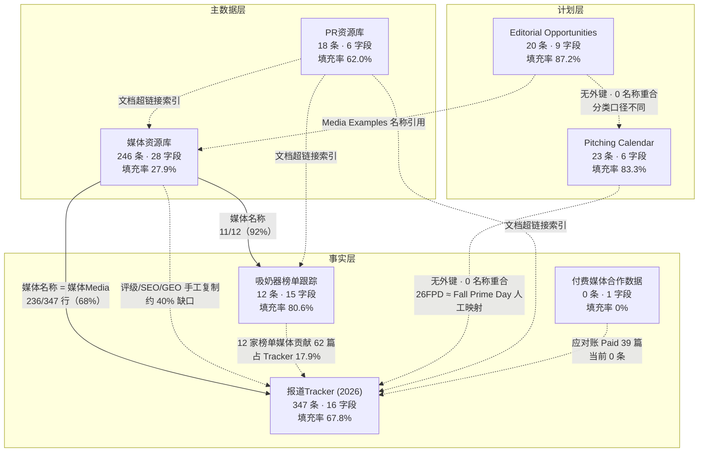

# 品牌 PR All-in-One 七表深度解读

**分析对象**：飞书多维表格「品牌PR All-in-One」7 张表  
**数据源**：`/Users/lute/Project/pr-agent/data/pr_all_in_one/_bundle.json`（全量字段与记录，705 KB）、`/Users/lute/Project/pr-agent/data/pr_all_in_one/_profile.json`（统计画像）  
**分析时点**：2026-10-31

**口径说明**
- 记录数、字段数以 `_bundle.json` 为准。`_profile.json` 快照含纯空行（媒体资源库 253 vs 246、PR资源库 19 vs 18、付费表 5 vs 0），本报告已按 bundle 剔除。
- 覆盖率 = 非空记录数 ÷ 总记录数；多选字段按整串计。
- “沉睡字段”定义：覆盖率 < 30%。

---

## 0. 总览

| # | 表 | table_id | 记录 | 字段 | 平均字段覆盖率 | 零覆盖字段 | 健康度 |
|---|---|---|---|---|---|---|---|
| 1 | 媒体资源库 | tblQeLQMUTJksdpK | 246 | 28 | 27.9% | 20 | C（有效字段 97.5%，但 71% schema 为空） |
| 2 | 媒体报道上线Tracker (2026) | tblMbzo85JLHoD2D | 347 | 16 | 67.8% | 2 | B |
| 3 | Pitching Calendar | tblQWXeJiyaj3iOp | 23 | 6 | 83.3% | 1 | B |
| 4 | Editorial Opportunities | tbl7qFl8pHrzQzKE | 20 | 9 | 87.2% | 0 | A- |
| 5 | 吸奶器榜单媒体进展跟踪 | tbl28vHwqjoCkeJB | 12 | 15 | 80.6% | 0 | B |
| 6 | PR资源库 | tblsW0pq7k94kNCI | 18 | 6 | 62.0% | 0 | C+ |
| 7 | 付费媒体合作数据 | tblKczikcczgTUo2 | 0 | 1 | 0% | 1 | F（空壳） |

7 张表合计 666 条记录、81 个字段。结构上分三层：**主数据层**（媒体资源库、PR资源库）、**事实层**（报道Tracker、吸奶器榜单、付费媒体）、**计划层**（Pitching Calendar、Editorial Opportunities）。

一句话判断：**两张表在真正运转（媒体库、Tracker），两张在排期（Calendar、Opportunities），一张在攻坚（榜单），一张是目录（资源库），一张是空壳（付费）。这不是一个系统，而是 7 张靠人脑和文件名连接的表。**

---

## 一、分表深度解读

### 1. 媒体资源库 (tblQeLQMUTJksdpK)

**业务定位**

PR 的媒体主数据表与目标池。写入方是媒体关系/PR ops，读取方是报道Tracker、吸奶器榜单跟踪、Pitching 计划和 Agency。典型场景有三个：季度媒体盘点、按评级排 pitch 优先级、给新市场/新品线搭媒体名单。它回答的是“我们认识谁、谁值得投”，不回答“我们和谁关系如何”。

**字段架构**

| 分组 | 字段（覆盖率） |
|---|---|
| 基础识别 | 媒体名称 100%、网站链接 100%、国家/地区 99.6% |
| 分类分级 | 媒体类别 92.3%、评级 98.4%、月流量量级 98.8%、SEO 权重 97.2%、GEO 权重 93.9% |
| 关系运营 | 无。没有编辑姓名、邮箱、联系历史、合作方式、最近互动、内部 Owner |
| 系统占位 | 父记录 0%、字段 1–19 全部 0% |

沉睡字段：**19 个“字段 N”占位符 + 父记录，合计 20 个零覆盖字段，占 28 个字段的 71%**。真正可用的只有 8 个字段，这 8 个字段的平均覆盖率为 97.5%。

**数据健康度**

- 记录数 246 / 字段数 28 / 平均字段覆盖率 27.9%（被 20 个空字段稀释）。
- 关键字段 Top 值：

| 维度 | 分布 |
|---|---|
| 评级 | A 138（57.0%）、B 46（19.0%）、S 35（14.5%）、C 23（9.5%）、空 4 |
| 流量层级 | Tier 3 <1M 88（36.2%）、Tier 2 1–10M 74（30.5%）、Tier 1 10–100M 62（25.5%）、Top ≥100M 19（7.8%） |
| 媒体类别 | Mother & Baby 64、Lifestyle 41、News 32、Tech 30、Women 14、Health 12、空 19 |
| SEO 权重 | Very High 132（55.2%）、High 94（39.3%）、Medium-High 9、Medium 1、Low 3 |
| GEO 权重 | High 84（36.4%）、Medium-High 73（31.6%）、Very High 46（19.9%）、Medium 22、Low 6 |
| 国家 | USA 245、空 1（100% 美国） |

- 交叉分布：S 级 35 家中 Top Tier 12、Tier 1 16、Tier 2 7、Tier 3 0；B 级 46 家中 42 家落在 <1M；C 级 23 家中 18 家落在 <1M。评级与流量层级几乎单调对应。
- 评级与 SEO 高度共线：S 级 32/35 为 SEO Very High，A 级 99/138 为 Very High，B 级 0 家 Very High。
- 数据质量问题：
  - **28 个字段中 19 个是“字段 N”占位符**，从未使用；加上父记录，71% 的 schema 是空的。
  - **评级顶层过重**：A 级占 57%，S+A 合计 71.5%，C 级仅 9.5%，区分度不足。
  - **评级口径混用**：6 家 Top Tier 新闻大牌（ABC、CBS、LA Times、Newsweek、WSJ、WaPo）被评为 A，而 Yahoo Life/Style/Tech 被评为 S。S 更像“已建立关系”，A 更像“高流量但未攻下”，但表里没有字段说明这层语义。
  - **国家单一值**：245/246 为 USA，无 UK/DE/CA；但榜单表已有 UK 媒体、Tracker 已有 UK/DE 落地。
  - **重复与脏数据**：Motherly 出现 2 条、Yahoo 系 3 条（Life/Style/Tech）；17 条“网站链接”无法解析出域名（纯文本或 Markdown 包裹）。
  - **无关系字段**：没有编辑联系人、联系历史、合作偏好、最近互动、内部 Owner，无法承担媒体关系 CRM 的职能。

**关键洞察**

1. **评级本质上是“流量 + SEO”的复合代理，不是“媒体价值”判断。** S 级 28/35 集中在 Tier 1 及以上，B/C 级 60/69 集中在 <1M；SEO Very High 与 S/A 高度重合。这导致两个盲区：高流量但难攻的顶级新闻媒体被压成 A，中等流量但高转化的垂类媒体被埋进 B/C。
2. **媒体库是“愿望清单”，不是“作战地图”。** 按精确名称匹配，246 家中仅 62 家（25%）在 2026 年 Tracker 中出现，184 家（75%）零产出；即使把 KTLA、Refinery29、USA Today 等 13 个写法变体归一，零产出仍约 170 家（69%）。S 级 35 家中 22 家（63%）有产出，13 家零产出，包括 CNN、TIME、WSJ、WaPo、Rolling Stone、Wired、The Verge、ELLE、Marie Claire、Verywell Health、Medical News Today、Popular Mechanics、E! Online。
3. **关系资产完全缺位。** 28 个字段里没有一个编辑姓名、邮箱、联系历史、合作偏好、最近互动。这些信息只存在于“吸奶器榜单”表的 11 位编辑名和个人记忆里。人员流动即关系流失，这是当前媒体库最大的结构性风险。
4. **地理单极化，扩盘没有主数据。** 国家字段 100% 美国；榜单表已有 Good Housekeeping UK、Women's Health UK、Made for Mums、The Independent，Tracker 也有 UK/DE 链接，但媒体库无法按国家筛选或建 UK/DE 子池。
5. **主数据质量不足以支撑自动化 join。** 19 个空字段、Motherly/Yahoo 重复、17 条链接不可解析、150 种媒体名写法（Tracker 侧）——任何“媒体库 → 报道”的自动关联都会漏掉约三成。

**与其他表的关联**

- **报道Tracker.媒体Media → 媒体资源库.媒体名称**：按名称连接，无 ID。137 个归一化媒体中 75 个可匹配（55%），347 行中 236 行可匹配（68%）；111 行（32%）来自 62 家库外媒体，最大缺口是 Yahoo Shopping 12 篇、Nappaawards 11 篇、PR Newswire 10 篇、Yahoo Creators 5 篇、GlobeNewswire 4 篇。
- **吸奶器榜单.媒体名称 → 媒体资源库**：12 家中 11 家可匹配，仅 The Independent 不在库内（92%）。
- **评级/SEO/GEO 是手工复制而非 lookup**：Tracker 中匹配行的 SEO 187/187、GEO 109/109 与媒体库完全一致，说明是复制粘贴；一旦媒体库改级，Tracker 历史记录不会同步。
- 与 Pitching Calendar、Editorial Opportunities **无任何媒体 ID 关联**，两张计划表里的媒体只以名称/示例形式出现。

---

### 2. 媒体报道上线Tracker (2026) (tblMbzo85JLHoD2D)

**业务定位**

PR 的成果台账，也是全 Base 唯一的事实表。写入方是 PR 执行与 Agency（每上线一篇录一条），读取方是 PR 负责人、品牌/市场、财务（earned value 估算）和管理层周报。典型场景：月度/大促复盘、媒体产出统计、向管理层汇报 coverage。它回答“我们今年被谁写了、写了什么、值多少钱”。

**字段架构**

| 分组 | 字段（覆盖率） |
|---|---|
| 基础 | 媒体 100%、文章标题 86.2%、发布链接 99.4%、发布时间 96.8% |
| 分类 | 媒体分类 99.1%、文章类型 98.6%、合作类型 99.7%、需求/项目 79.0%、品线 0% |
| 度量 | 媒体评级 59.9%、媒体月流量 66.6%、SEO 59.4%、GEO 59.9% |
| 内容 | 露出产品 75.2%、备注 4.6% |
| 系统 | 父记录 0% |

沉睡字段：**品线（0%）、父记录（0%）、备注（4.6%）**。半沉睡字段：SEO/GEO/媒体评级约 40% 空缺，媒体月流量 33% 空缺。

**数据健康度**

- 记录数 347 / 字段数 16 / 平均字段覆盖率 67.8%。
- 关键字段 Top 值：

| 维度 | 分布 |
|---|---|
| 合作类型 | Earned 267（76.9%）、Paid 39（11.2%）、Awards 18（5.2%）、Press Release 17（4.9%）、Organic 4（1.2%）、调研/白皮书 1、空 1 |
| 文章类型 | Promotion/Deal/Event 117（33.7%）、Product Roundup/Listicle 59（17.0%）、Brand Storytelling 48（13.8%）、Buying Guide/Gift Guide 40（11.5%）、Awards 38（11.0%）、Press Release 17（4.9%）、Product Intro/Review 14（4.0%）、Event promotion 9（2.6%）、空 5 |
| 项目 | 26FPD 59、Prime Day Sale 40、日常推广 26、品牌日2026 22、Breastfeeding Month 19、奖项类 32（4 种写法）、空 73 |
| 媒体 | BuzzFeed 36、Parents 16、Good Housekeeping 14、The Bump 13、Nappaawards 11、PR Newswire 10、MSN 9、NJ.com 9、SheKnows 7、Babylist 7 |
| 月度 | 2026-10 68、06 51、09 42、07 36、03 31、05 31、04 26、01 24、08 16、02 11、无日期 11 |
| 媒体评级 | S 100、A 103、B 5、空 139 |

- 日期范围 2026-01-02 至 2026-10-30，130 个不同日期；峰值日 10-07（23 篇）、06-23（20 篇）、10-06（19 篇）、07-27（14 篇）。
- 数据质量问题：
  - **品线字段 100% 为空**，无法按产品线出报表，只能从“露出产品”自由文本反推。
  - **合作类型出现 schema 外值**：“调研/白皮书”1 条不在 5 个标准选项内。
  - **项目命名失控**：56 种写法（大小写归一后 55 种），奖项被写成“奖项/Award/Awards/年度榜单获奖”4 种；Mother's Day 相关有 10 余种写法；空值 73 条（21%），其中 4 月 20/26 条为空（77%）。
  - **产品命名失控**：170 种写法、261 条有值；KleanPal / KleanPal Pro / DeepClean D8 / DeepClean Baby Bottle Washer (D8) 是同一产品族；25% 记录无产品。
  - **媒体类型字段混入非类型值**：86 种组合，含 “Calendar Listing”12 条、“Press release”6 条、“news”小写 1 条；多选被写成逗号串，无法直接聚合。
  - **评级/SEO/GEO 约 40% 空缺**，且空缺与“媒体不在库内”高度重合，是结构性缺失而非录入遗漏。
  - **重复内容**：11 个重复 URL；标题重复最高 7 次（Babylist NYC Showroom Grand Opening）、5 次（Working Motherhood、Breastfeeding 研究稿）、4 次（Allyson Felix 稿），说明通稿/联合发布被多 outlet 重复计入。
  - **链接与标题缺失**：11 条无日期、48 条无标题、2 条无链接。

**关键洞察**

1. **“Earned-First”成立，但内容是“Deal-Led”。** Earned 267 篇（76.9%）是绝对主导，但内容结构是 Promotion/Deal/Event 117（33.7%）+ Product Roundup 59（17.0%）+ Buying Guide 40（11.5%）= 216 篇（62.2%）的 commerce-oriented 内容；Brand Storytelling 仅 48 篇（13.8%）。PR 实际在承担“带货内容引擎”的职能，品牌叙事产能偏薄。
2. **产出由大促脉冲驱动，峰谷极陡。** 10 月 68 篇（占全年 19.6%）、6 月 51 篇（14.7%）、8 月仅 16 篇（4.6%），峰谷差 4.25 倍；10-06 与 10-07 两天合计 42 篇（12.1%），全部集中在 Prime Big Deal Days。26FPD（2026 Fall Prime Day）59 篇 + Prime Day Sale（夏季 Prime Day）40 篇 = 99 篇，占全年 28.5%；若加上 2 条“Prime Day”则为 101 篇、29.1%。10 月 68 篇中有 53 篇（78%）挂在 26FPD 下；6 月 51 篇中有 37 篇（73%）挂在 Prime Day Sale 下。
3. **媒体集中度与长尾虚胖并存。** BuzzFeed 单家 36 篇（10.4%），Top 10 媒体合计 40.1%，17 家媒体（≥5 篇）贡献 177 篇（51.0%）；另一端 87 家媒体全年只产出 1 篇（占 137 个归一媒体的 63.5%）。单点依赖（BuzzFeed 掉线即损失约 1/10 年产出）与“广撒网但无深度”同时存在。
4. **归属链路断裂，产品贡献被低估。** 品线 0%；产品 170 种写法、25% 空缺；媒体评级/SEO/GEO 各约 40% 空缺，恰好对应 32% 报道来自库外媒体。更关键的是：榜单表里编辑实际提及 S12 Pro 6 次、M5 5 次，而 Tracker 的“露出产品”字段中 **S12 Pro 出现 0 次**——说明该字段只记录了“我们 pitch 的产品”，没有记录“编辑实际写了什么”，有机露出被系统性漏记。
5. **分类体系已不可直接用于决策。** 56 种项目写法、170 种产品写法、86 种媒体类型组合、150 种媒体名写法。任何按项目/产品/媒体类型的透视都需要先做清洗层，否则“26FPD 59 篇”这类数字会因拼写差异被低估或高估。8 月只有 16 篇，其中 8 篇是 Awards（50%），说明 8 月靠奖项申报撑住，日常 earned 几乎停摆。

**与其他表的关联**

- **→ 媒体资源库**：名称连接，236/347 行（68%）可匹配；111 行（32%）来自库外媒体。这是全 Base 唯一真正被使用的 join。
- **→ Pitching Calendar**：无外键。项目名“26FPD”对应日历里的“Fall Prime Day”（1 条），但“Prime Day Sale”40 篇在日历中完全没有对应条目——夏季 Prime Day 不在滚动日历窗口内（日历从 2026-09 开始）。
- **→ Editorial Opportunities**：语义可映射（Amazon Prime Big Deal Days、Black Friday/Cyber Monday、Christmas & New Year），但无共享键，名称 0 重合。
- **→ 吸奶器榜单**：12 家榜单媒体合计贡献 62 篇（17.9%），其中 Good Housekeeping 14、Parents 16、The Bump 13、Babylist 7、Forbes 5、Consumer Reports 3、Wirecutter 1、Wired 0。
- **→ 付费媒体合作数据**：Tracker 有 39 条 Paid，但付费表 0 条记录，应付/结算侧完全断链。

---

### 3. Pitching Calendar (tblQWXeJiyaj3iOp)

**业务定位**

PR 的战役节奏表。写入方是 PR 负责人/战役 owner，读取方是 PR 执行、Agency、跨部门（品牌、电商、产品）用于对齐发布节奏。典型场景：大促、品牌日、展会前 4–8 周的 pitch 排期。它回答“什么时候打什么仗”。

**字段架构**

| 分组 | 字段（覆盖率） |
|---|---|
| 机会 | Opportunity Name 100%、Editorial Opportunity Type 100% |
| 时间 | 开始日期 100%、结束日期 100%、日期 0% |
| 产品 | Key Product 100%，但 9 条为“/”、3 条为“TBD”，仅 11 条有具体产品 |
| 缺失 | 无 Owner、Status、Target Media、Channel、KPI、Budget、Pitch Angle 字段 |

沉睡字段：**“日期”0%**（与开始/结束日期重复的废弃列）。

**数据健康度**

- 记录数 23 / 字段数 6 / 平均字段覆盖率 83.3%。
- 关键分布：

| 维度 | 分布 |
|---|---|
| 类型 | Brand Campaign 11（47.8%）、Promotion 6（26.1%）、Cultural/Awareness Moment 4（17.4%）、Product Pitching 2（8.7%） |
| 开始月份 | 2026-09 5、2026-10 2、2026-11 4、2026-12 3、2027-01 4、2027-02 5 |
| 产品 | “/” 9（39.1%）、TBD 3（13.0%）、具体产品 11（47.8%） |
| 结束月份 | 2027-02 5、2026-11 4、2026-09/10/12 各 3、2027-01 2、2027-03 2、2027-10 1 |

- 数据质量问题：
  - **时间跨度异常**：Broadcast Blitz for BFCM 开始 2026-10-01、结束 2027-10-31，跨度 395 天，几乎可以确定是笔误（应为 2026-10-31 或 2026-11-30）。
  - **产品不可执行**：52% 的条目没有可执行产品（“/” + TBD）。
  - **单条塞多 SKU**：Brand Day Core Products 一条记录塞了 9 个 SKU（W1 Pump、BirthEase Maternity Ball Set、D8、Triple-Seal Diaper Pail、2-in-1 Electric Baby Swing、Smart Baby Sound Machine、BreezyClear Nasal Aspirator、BM08、PureHug Baby Carrier），无法按产品归因。
  - **无执行字段**：没有 Owner、Status、Target Media、KPI、Budget，无法判断“计划了”还是“执行了”。

**关键洞察**

1. **品牌战役占近一半，产品 pitch 仅 8.7%，与 Editorial Opportunities 的 55% 新品角度直接冲突。** 两张计划表对“今年在打什么”没有共识：日历说品牌战役为主，机会库说新品上市为主。
2. **一半条目没有产品锚点。** “/” 39% + TBD 13% = 52%，意味着无法按 SKU 预测 PR 资源、无法做产品级归因；Brand Day 一条塞 9 个 SKU 进一步让归因失效。
3. **它是“日期清单”，不是“作战日历”。** 6 个字段里没有 Owner、Status、Target Media、KPI、Budget；计划与执行之间没有对账字段，只能靠 Tracker 反推。
4. **2027-02 资源撞车。** 单月堆了 5 个战役：International Women's Day Campaign、IWD Event、Nursery Recliner Launch、LA Showroom Opening、Breast and Belly Skincare Guide。以现有团队规模，2 月会出现 pitch 产能挤兑。
5. **滚动窗口只有 6 个月。** 2026-09 至 2027-02，没有全年视图；夏季 Prime Day（40 篇产出）不在窗口内，导致最大的单个 campaign 没有排期记录。

**与其他表的关联**

- **→ 报道Tracker**：无外键。仅“Fall Prime Day”与“26FPD”可人工对应；Black Friday/Cyber Monday 对应 Tracker 里零散的“品牌日/BFCM”记录，但无稳定映射。
- **→ Editorial Opportunities**：名称 0 重合；类型口径不同（Product Pitching vs New Product Launch）；时间窗不同（Calendar 到 2027-03，Opportunities 只到 2026-12）。
- **→ 媒体资源库**：无媒体字段，无法回答“这个 campaign 打算打哪些媒体”。

---

### 4. Editorial Opportunities (tbl7qFl8pHrzQzKE)

**业务定位**

PR 的选题与角度库。写入方是 PR 策略/内容策划，读取方是 PR 执行与 Agency（拿来写 pitch）、内容/社媒（复用叙事）。典型场景：新品上市、文化节点、CSR 选题的 angle 设计。它回答“用什么故事打什么媒体”。

**字段架构**

| 分组 | 字段（覆盖率） |
|---|---|
| 机会定义 | Opportunity Name 100%、Editorial Opportunity Type 100%、Key Product 65% |
| 打法 | Pitch Angle 70%、Pitch Timing 80%、Target Media Type 100%、Media Examples 70% |
| 时间 | 开始日期 100%、结束日期 100% |

无零覆盖字段，但有 2 个字段低于 70%（Key Product、Pitch Angle/Media Examples）。

**数据健康度**

- 记录数 20 / 字段数 9 / 平均字段覆盖率 87.2%。
- 关键分布：

| 维度 | 分布 |
|---|---|
| 类型 | New Product Launch 11（55%）、Cultural/Awareness Moment 6（30%，含 1 条双类型）、Brand Campaign 2、Promotion 2 |
| 目标媒体类型 | Mother&baby 16、News 16、Lifestyle 14、Women 5、Health 3、Tech 1 |
| 时间 | 2026-09 4、2026-10 6、2026-11 7、2026-12 3（无 2027 条目） |
| 完整度 | Pitch Angle 14/20、Media Examples 14/20、Pitch Timing 16/20、Key Product 13/20 |

- 数据质量问题：
  - **6/20（30%）缺 3 个以上核心字段**：Institutional Course Partnership、Baby Nasal Aspirator（BN09）、V3 Pro、V3、Multi-functional Light Therapy Device、Muslin Baby Carrier（CB004）。
  - **2 条缺 Key Product**：World Prematurity Day、AirMesh Nursing Bra。
  - **产品与机会名不一致**：M5 Ultra 条目的 Key Product 写成 “M8 Breast Pump”，Pitch Angle 也写 M8；D8 条目 Key Product 是 “All products”，但 Pitch Angle 是劳工节折扣；V3 与 V3 Pro 重复建条且都无产品/角度。
  - **时间窗只覆盖 Q4**：20 条全部 start 2026-09 至 2026-12，没有 2027 条目。
  - **语言不统一**：Pitch Angle 全中文，而实际 pitch 给美国编辑需要英文，存在二次翻译成本。

**关键洞察**

1. **这是全 Base 最有价值的“叙事资产”。** 14/20 有完整 Pitch Angle，主题集中在安全睡眠/SIDS、产后心理与隐形劳动、孕晚期疼痛、CSR（Rainbow Baby、PSI 捐赠）、母乳喂养挑战、NICU、睡眠科学。这些角度是品牌编辑人格的原始素材，可直接升级为 OGSM 的“叙事策略”输入。
2. **但它只是 Q4 工作表，不是活的选题库。** 20 条全部落在 2026-09 至 2026-12；Pitching Calendar 已排到 2027-03，Opportunities 没有跟着滚动。2027 的 IWD、Valentine's、Amazon Baby Sale 在日历里有，在机会库里没有。
3. **一半新品不可执行。** 11 个 New Product Launch 中 6 个缺 3 个以上核心字段，只有 5 个 pitch-ready（National Baby Safety Month、D8、Ergonest、Breast Cancer Awareness、World Mental Health Day、Amazon Prime Big Deal Days、M5 Ultra、Sound Machine、BFCM、Milk Warmer、Christmas 等完整条目中的新品部分）。按现有状态，新品 pipeline 有一半需要重做才能外发。
4. **媒体靶心偏窄，漏掉 tech-review 决策链。** Mother&baby 16、News 16、Lifestyle 14，Tech 仅 1、Health 3；而产品组合已包含监护器、智能声机、APP 泵、光疗设备。Wirecutter、NBC Select、The Verge、CNET 这条“ tech review → 购买决策”链路在目标媒体类型里几乎缺席。
5. **分类口径与日历漂移。** 这里叫 “New Product Launch”，日历叫 “Product Pitching”；这里叫 “Cultural/Awareness Moment”，日历叫 “Cultural/Awareness Moment”，但任务描述里又叫 “Cultural Moment”。同一概念三种写法，且两表 0 名称重合，无法自动对齐。

**与其他表的关联**

- **→ Pitching Calendar**：0 名称重合，0 外键；只能靠人工把 “Amazon Prime Big Deal Days” 映射到 “Fall Prime Day”，把 “Black Friday / Cyber Monday” 映射到 “Black Friday/Cyber Monday”。
- **→ 媒体资源库**：Media Examples 以名称引用（BabyCenter、The Bump、Wirecutter、Forbes Vetted、Motherly 各出现 2 次），无 ID。
- **→ 报道Tracker**：无结果字段（没有 “是否拿到 coverage”“上线链接”），无法闭环评估哪个 angle 有效。

---

### 5. 吸奶器榜单媒体进展跟踪 (tbl28vHwqjoCkeJB)

**业务定位**

吸奶器品类的榜单渗透 tracker，是全 Base 唯一按“媒体 × 编辑 × 结果”组织的攻坚表。写入方是 PR owner + Agency（Co-Op），读取方是 PR 负责人、产品市场、管理层。典型场景：Forbes、Consumer Reports、Wirecutter、Good Housekeeping 等核心 review 媒体的榜单攻坚与入选复盘。它回答“我们在核心榜单里进了没有、为什么没进”。

**字段架构**

| 分组 | 字段（覆盖率） |
|---|---|
| 媒体/编辑 | 媒体名称 100%、媒体类别 100%、国家 100%、Editor Name 91.7%、Editor 联系历史 58.3%、Media owner 58.3% |
| 进展 | Pitching Status 100%、Update 58.3%、Agency Notes 33.3% |
| 结果 | 本篇报道是否有入选 83.3%、Momcozy 是否已出现 100%、报道角度 75%、角度标签 66.7%、对应产品 83.3%、品类词报道链接 100% |

无零覆盖字段，但 5 个字段低于 60%（Agency Notes 33.3%、联系历史/Media owner/Update 58.3%、角度标签 66.7%）。

**数据健康度**

- 记录数 12 / 字段数 15 / 平均字段覆盖率 80.6%。
- 12 家媒体：Forbes、Consumer Reports、Good Housekeeping、Wirecutter (The New York Times)、Women's Health、Parents、Wired、The Strategist (New York Magazine)、Made for Mums、The Independent、Babylist、The Bump。全部是高权威 review/ranking 媒体。
- 关键分布：

| 维度 | 分布 |
|---|---|
| Pitching Status | pitched W1 10、pitched W1 + follow up 1、W1 入围但没获奖 1 |
| 本篇是否入选 | 是 5、否 5、空 2 |
| 是否已出现 | True 11（91.7%）、False 1（The Independent） |
| 对应产品 | S12 Pro 6、M5 5、M9 3、S9 Pro 2、M6 1、Air1 1、V1 Pro 1 |
| 报道角度 | 性价比 3（+1 组合）、便携 2、初学者 1、贴合/app 1、空 4 |
| 地区 | USA 10、USA/UK 1、UK 1 |

- 数据质量问题：
  - **Update 字段停留在 8.01–8.04**，距分析时点 3 个月，状态未刷新。
  - **2 条缺“是否入选”结论**（Babylist、The Bump 之一），无法计算完整转化率。
  - **5 家媒体无编辑联系历史、5 家无内部 Media owner**。
  - **没有排名位次、文章日期、coverage URL、下次跟进日期**，只有“是/否”二元结果。
  - **Editor Name 有一条是流程备注**（“奖项申报通道，撰写编辑 Madeline Weinfield”），不是规范人名。
  - **Agency Notes 仅 4 条**，Co-Op 的动作记录不完整。

**关键洞察**

1. **认知已解决，入选才是瓶颈。** 12 家媒体中 11 家（91.7%）已经出现过 Momcozy；但在 10 条有结论的记录里，入选 5 条、未入选 5 条，转化率 50%（按 12 条计为 41.7%）。问题不是“编辑不知道我们”，而是“编辑不选我们进榜单”。
2. **Pitch 与报道严重错位。** 12/12 都在 pitch W1，但编辑实际写的是 S12 Pro（6）、M5（5）、M9（3）、S9 Pro（2），**W1 在“对应产品”字段零提及**。W1 的故事没有被采纳，被采纳的是“性价比”故事。这是全 Base 最清晰的一条“pitch 无效”证据。
3. **品牌被锚定在“best value/budget”，不是 premium。** 性价比 3+1 是绝对主导角度，便携 2、初学者 1。这是对 Spectra/Medela/Elvie 的挑战者定位，优点是容易进榜，代价是 premium 心智缺位；只有 Parents 一家给了 M5 “Best Hands-Free/Best Overall”，The Bump 给了 Air1 “Best Discreet”、V1 Pro “Overall Best Hands-Free”。
4. **关系单点化，关键人风险高。** 7 条联系历史集中在 Anna Xu（4）与 Chloe（2，另 1 条两人共同）；5 家媒体无联系记录、5 家无内部 Owner。Agency 侧 Co-Op 的动作只在 4 条 Agency Notes 里出现，关系资产没有沉淀到表内。
5. **跟踪已过期且分辨率不足。** Update 停在 8 月初；没有排名位次（第 1 名 vs 第 5 名）、没有文章日期、没有 URL、没有下次跟进。按当前表结构，无法计算 share of voice、无法看排名趋势、无法做“pitch → 入选 → 排名”的漏斗。

**与其他表的关联**

- **→ 媒体资源库**：11/12 可匹配（The Independent 不在库内）；这 12 家媒体在 Tracker 中合计贡献 62 篇（17.9%），是全年产出密度最高的一组媒体。
- **→ 报道Tracker**：无外键。榜单结果与 Tracker 文章不互相引用；例如 The Bump 的 13 篇 Tracker 文章与“W1 入围但没获奖”这条记录无法关联。
- **→ Pitching Calendar / Editorial Opportunities**：无关联。榜单攻坚是独立于 campaign 日历的常设工作，但没有在日历中体现档期。

---

### 6. PR资源库 (tblsW0pq7k94kNCI)

**业务定位**

PR 文档与资产索引，相当于团队知识库的目录页。写入方是 PR ops，读取方是全团队、新人、交接人。典型场景：找模板、找媒体名单、找奖项授权、找 campaign 工作文档。它回答“东西在哪、谁负责”。

**字段架构**

| 分组 | 字段（覆盖率） |
|---|---|
| 文档 | 文档名称 94.4%、文档类型 66.7%、文档附件 83.3%、Note 11.1% |
| 归属 | Owner 72.2%、Parent items 44.4% |

沉睡字段：**Note 11.1%**；半沉睡：Parent items 44.4%、文档类型 66.7%。

**数据健康度**

- 记录数 18 / 字段数 6 / 平均字段覆盖率 62.0%。
- 关键分布：

| 维度 | 分布 |
|---|---|
| 文档类型 | PR资源 4、工作文档 4、Trackers 2、洞察分析 2、空 6（33.3%） |
| Owner | 庄宇铃 4、郭薇 3、肖熠君 3、高雅静 2、邓苇 2、空 5（27.8%） |
| 层级 | Brand campaigns 5 个子项（Brand Day、BFM、Father's Day、PSI 课程、BFCM）；Awards 3 个子项（奖项申请管理、奖项授权需求登记、已授权奖项汇总）；其余平铺 |

- 文档清单（17 条有名称）：媒体文章上线汇总、媒体关系管理/Media Core List、2026年奖项申报 Awards、PR Media Kit、MuckRack 账户信息、奖项申请管理、奖项授权需求登记、已授权奖项汇总、品牌Campaigns PR 工作文档汇总、2026 Brand Day、2026 BFM、PR核心媒体现状分析（吸奶器品线）、2026 Father's Day、2026 PSI专业课程合作、2026 BFCM、Momcozy词云分析、通稿发布日历。
- 数据质量问题：
  - **6/18（33%）无文档类型**，5/18（28%）无 Owner，3 条无附件，1 条无名称（只有“工作文档”类型）。
  - **索引不覆盖本 Base**：没有“吸奶器榜单跟踪”“Pitching Calendar”“Editorial Opportunities”“付费媒体”的条目。
  - **无 2027 规划文档、无危机/SOP 文档、无付费媒体文档**。
  - **命名中英混用**：BFM、BFCM、PSI、Media Core List 等缩写无解释；新人无法自解释。
  - **层级只建了两层**，其余平铺；查找依赖命名纪律。

**关键洞察**

1. **它是 PR 操作系统的“目录页”，能反推出团队真实工作流。** 覆盖 Tracker、Media Core List、Awards、Media Kit、MuckRack、Brand Day/BFM/Father's Day/PSI/BFCM、词云、通稿日历——五类文档（Trackers、PR资源、洞察分析、外发资料、工作文档）中四类有代表，说明团队的工作面是完整的。
2. **但目录本身不可信。** 三分之一无类型、四分之一无 Owner、六分之一无附件；作为“单一索引”不可用，实际查找仍然靠群聊和记忆。
3. **只索引了过去，没有索引未来。** 全部是 2026 已发生/进行中的 campaign；没有 2027 规划、没有本 Base 的 7 张表、没有危机响应/SOP、没有付费媒体结算文档。目录的时间方向是向后看的。
4. **两级层级只覆盖了 Brand Campaign 和 Awards。** 这两个恰好是“多文档、跨人协作”的场景，说明层级是按痛点长出来的；但媒体关系、洞察分析、Tracker 仍然是平铺。
5. **Owner 集中且无备份。** 13 条有主文档集中在 5 人，庄宇铃 4、郭薇 3、肖熠君 3；没有 backup/交接字段。结合榜单表的“联系历史集中在 2 人”，团队存在明显的关键人依赖。

**与其他表的关联**

- **→ 报道Tracker**：通过“媒体文章上线汇总 → Media Coverage Tracker - 总表”外链索引；但该链接指向另一个 wiki/表，不是本 Base 的 tblMbzo85JLHoD2D，存在“双 Tracker”风险。
- **→ 媒体资源库**：通过“媒体关系管理/Media Core List”外链索引；同样不是本 Base 的 tblQeLQMUTJksdpK。
- **→ 吸奶器榜单**：通过“PR核心媒体现状分析（吸奶器品线）”间接关联，无表级链接。
- **→ 所有表**：只有文档超链接，没有记录 ID 或表 ID 的结构化引用，属于“人工索引”而非“系统集成”。

---

### 7. 付费媒体合作数据 (tblKczikcczgTUo2)

**业务定位**

付费媒体合作台账（应有）。写入方应是 paid media/Agency/财务，读取方是 PR 负责人、市场、财务。典型场景：付费合作预算、结算、效果复盘。当前是空壳，业务上等于“没有这个职能的表”。

**字段架构**

| 分组 | 字段（覆盖率） |
|---|---|
| 唯一字段 | “文本” 0% |

只有 1 个 text 字段，既不是金额、也不是媒体、也不是档期，连表结构都未设计。

**数据健康度**

- 记录数 0 / 字段数 1 / 平均字段覆盖率 0%。
- 无 top 值、无分布、无质量可言——这是一张“建了但从未使用”的表。

**关键洞察**

1. **空表是最强信号：付费媒体从未被结构化管理。** 0 记录、1 个“文本”字段、0% 覆盖，说明这张表只是占位，没有进入任何人的工作流。
2. **但付费已经真实发生。** Tracker 里有 39 条 Paid（11.2%），10 月 12 条（占当月 17.6%），26FPD 12 条（占付费 30.8%）；1 月 6/24（25%）、5 月 8/31（25.8%）也是付费高峰。
3. **付费被当成“大促放大器”，不是品牌建设。** Paid 内容 17/39 是 Promotion/Deal/Event、9 篇 Product Introduction/Review，两者合计 26/39（66.7%）；Brand Storytelling 仅 7 篇。付费在替大促做转化，而不是替品牌做心智。
4. **无法回答任何 ROI 问题。** 没有媒体、档期、位置、金额、币种、Agency、发票、曝光、点击、折扣码，无法算 CPM、CPA、earned lift，也无法判断“付费是否带来了自然覆盖”。
5. **双源风险。** 财务/采购大概率在 Excel 里另记一份；Base 空表 + 线下表 = 对账缺口。一旦被问“今年付费花了多少、哪家媒体最有效”，当前无法回答。

**与其他表的关联**

- **→ 报道Tracker**：应通过“媒体 + 时间 + 项目”对账 39 条 Paid 记录，但付费表 0 条，连接不存在。
- **→ 媒体资源库**：应通过媒体 ID 关联评级/流量，无连接。
- **→ Pitching Calendar**：付费档期应与大促日历对齐（26FPD、Prime Day、BFCM），无连接。
- **→ PR资源库**：没有付费媒体文档条目，说明连“索引”都还没建。

---

## 二、7 张表的关系图谱

### 2.1 结构图

实线 = 已实现的结构化 join；虚线 = 语义关联/断链；箭头方向 = 读取方向。

### 2.2 关系强度矩阵

| 源表 | 目标表 | 连接键 | 基数 | 实测匹配 | 状态 |
|---|---|---|---|---|---|
| 媒体资源库 | 报道Tracker | 媒体名称 = 媒体Media | 1:N | 236/347 行（68%）；75/137 媒体（55%） | 已实现，靠名称，无 ID |
| 媒体资源库 | 吸奶器榜单 | 媒体名称 | 1:N | 11/12（92%） | 已实现，靠名称 |
| 吸奶器榜单 | 报道Tracker | 媒体名称 | 1:N | 12 家媒体 62 篇（17.9%） | 语义关联，无外键 |
| Pitching Calendar | 报道Tracker | 项目/机会名 | 1:N | 0 直接匹配；26FPD ≈ Fall Prime Day | 断链，需人工映射 |
| Editorial Opportunities | Pitching Calendar | 机会名 | 1:N | 0/23 名称重合 | 断链，分类口径不同 |
| Editorial Opportunities | 媒体资源库 | Media Examples 名称 | N:N | 部分引用（BabyCenter、The Bump、Wirecutter 等） | 弱关联 |
| PR资源库 | 其他 6 表 | 文档超链接 | 1:N | 仅 3 条指向外部 Tracker/媒体名单 | 人工索引，非结构化 |
| 付费媒体合作数据 | 报道Tracker | 媒体 + 时间 + 项目 | 1:N | 0 条 vs 39 条 Paid | 断链 |

### 2.3 系统性结论

1. **这是“7 张表”，不是“1 个系统”。** 只有 2 条真正的表间连接（媒体库 → Tracker、媒体库 → 榜单），其余 5 张表靠人脑、文件名和超链接连接。没有共享 ID、没有 lookup 字段、没有 rollup。
2. **缺 5 个主数据/维度。** Campaign（56 种项目写法，无 master）、Product/SKU（170 种产品写法，品线字段 0%）、Editor/Contact（只在榜单表有 11 人）、Agency（只在榜单表 Agency Notes 出现）、Paid（表为空）。
3. **名称主键导致 32% 的报道无法归属媒体库。** Yahoo Shopping（12 篇）、Nappaawards（11）、PR Newswire（10）、Yahoo Creators（5）、GlobeNewswire（4）等 62 家媒体不在库内；同时约 170 家库内媒体零产出。媒体库与 Tracker 是“两个世界”。
4. **计划与执行是两套语言。** Pitching Calendar 用 Brand Campaign/Promotion/Cultural/Product Pitching，Editorial Opportunities 用 New Product Launch；两表 0 名称重合；Calendar 到 2027-02，Opportunities 到 2026-12；Tracker 的项目字段又是第三套写法（26FPD、Prime Day Sale、品牌日2026）。
5. **度量链断裂。** 从“机会 → pitch → 上线 → 榜单入选 → 付费”没有任何一列可以串起来。付费表为空使 ROI 不可计算；榜单表无排名位次使 SOV 不可计算；Tracker 无品线使产品级归因不可计算。

### 2.4 数据治理优先级

| 优先级 | 动作 | 解决什么 | 验收标准 |
|---|---|---|---|
| P0 | 建 Campaign 字典 + Product/SKU 字典；媒体名称归一并引入 media_id | 56 种项目写法、170 种产品写法、150 种媒体写法 | Tracker 可按项目/产品/媒体透视；媒体库匹配率 ≥90% |
| P0 | 把“品线”字段填起来，或直接删除 | 0% 覆盖的死字段 | 品线维度可出报表 |
| P1 | Tracker 的评级/SEO/GEO 改为 lookup/公式，从媒体库自动带出 | 40% 空缺、手工复制漂移 | 覆盖率 ≥95%，改级自动同步 |
| P1 | 媒体库补 Editor/Contact/Country 多值/关系等级/内部 Owner | 关系资产缺位、USA 单极 | 每家 S/A 媒体有 1 名编辑 + 1 名内部 Owner |
| P1 | 榜单表补排名位次、文章日期、coverage URL、下次跟进日期 | 跟踪 3 个月未更新、只有是/否 | 每月更新，可算 SOV 与排名趋势 |
| P2 | 付费表建 schema，并对账 Tracker 的 39 条 Paid | 0 记录、ROI 不可算 | 金额/档期/媒体/链接/发票五要素齐全 |
| P2 | Pitching Calendar 补 Owner/Status/KPI/Target Media；EO 补 Status/Result 并滚动到 2027 | 计划无法对账、机会库不滚动 | 计划-执行-结果可串成一条链 |

### 2.5 可直接用于 OGSM/GAP 的 8 个量化事实

- **产出规模**：2026 年 1–10 月 347 篇，Earned 267 篇（76.9%）；但 62.2% 是 deal/guide/roundup commerce 内容，Brand Storytelling 仅 13.8%。
- **节奏**：10 月 68 篇（19.6%）、6 月 51 篇（14.7%）、8 月 16 篇（4.6%），峰谷差 4.25 倍；10-06/07 两天 42 篇（12.1%）。
- **集中度**：BuzzFeed 36 篇（10.4%）；Top 10 媒体 40.1%；17 家媒体贡献 51.0%；87 家媒体仅 1 篇。
- **媒体库存**：246 家中 62 家（25%）有产出，约 170 家（69%）零产出；S 级 35 家中 22 家（63%）有产出，13 家零产出。
- **榜单**：12 家核心 review 媒体，11 家已出现过 Momcozy，入选 5/10（50%）；12/12 pitch W1，编辑实际写 S12 Pro/M5/M9/S9 Pro，W1 零提及。
- **计划**：23 条日历中 9 条无产品（39.1%）、3 条 TBD（13.0%）；6 个字段无 Owner/Status/KPI；2 月单月 5 个战役。
- **付费**：39 篇（11.2%），26FPD 占 12 篇（30.8%）；付费表 0 条记录，ROI 不可计算。
- **治理**：品线 0%、项目 56 种写法、产品 170 种写法、媒体类型 86 种组合、媒体名 150 种写法——任何自动化分析前必须先做清洗层。